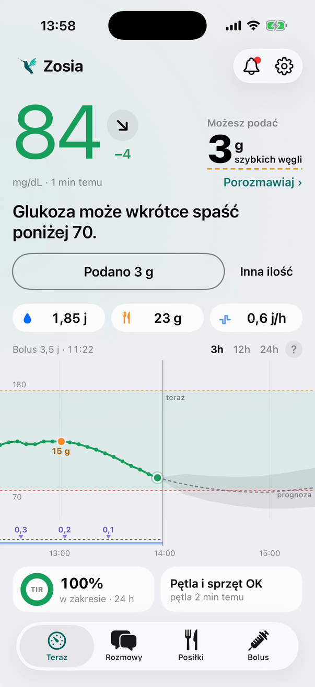
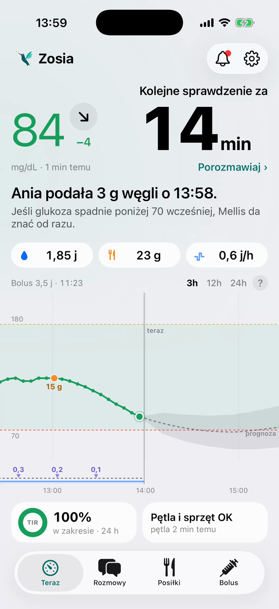
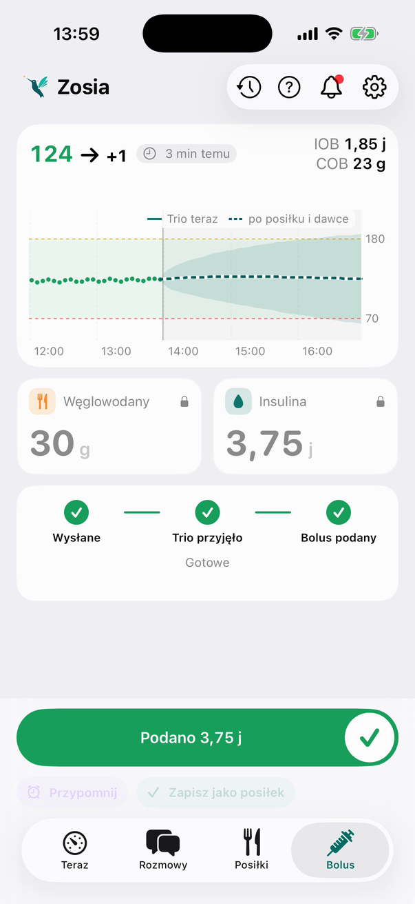
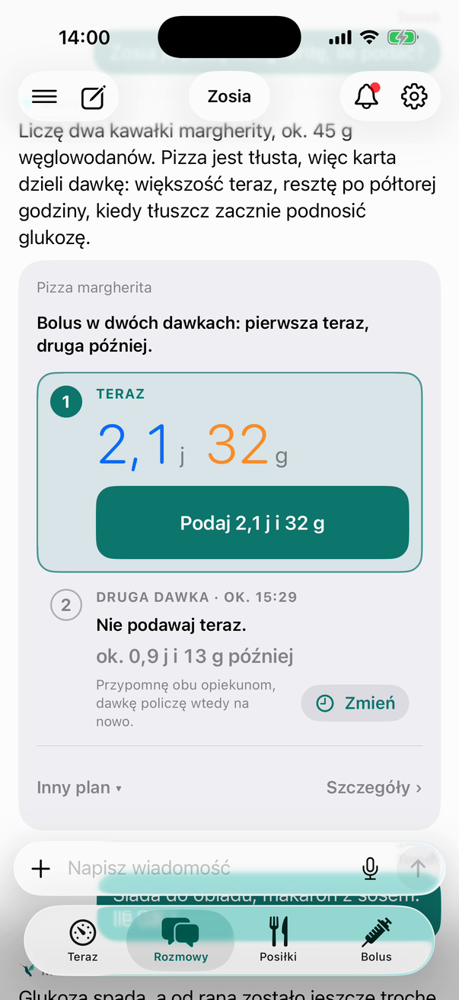
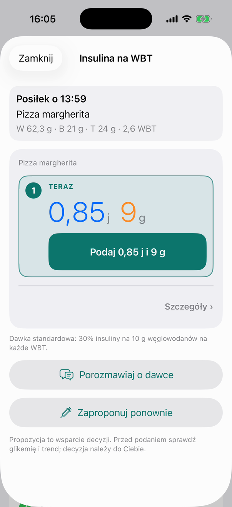
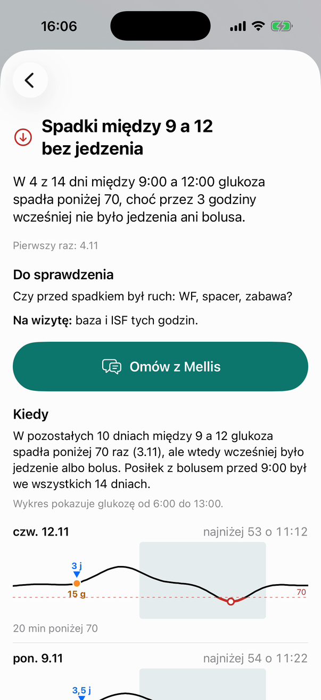

# Mellis

**A calm assistant for people with type 1 diabetes and their caregivers.** Mellis reads your Nightscout, helps you
count a meal (also from a photo), reminds you about the second part of a split bolus, warns about a coming low and
answers questions about what your glucose is doing. It works with **Trio** and **Loop**, and can send a bolus or
carbs to the loop straight from the phone, every command confirmed with Face ID.

You install Mellis yourself, the way you build Trio or Loop: **your own server, your own AI key, your own Apple
Developer account.** There is no central service, no sign-up with us and no analytics; your data stays with you and the AI
provider you choose (OpenAI or Anthropic).

Documentation (Polish): **https://mheblewski.github.io/Mellis/**

> [!NOTE]
> **Mellis is currently available in Polish only** (app, notifications, AI answers, installers and documentation).

> [!WARNING]
> **Mellis is a DIY project, not a medical device.** It has no CE mark and no FDA clearance. Dose, carb and setting
> suggestions are hints; you always decide. The AI can be wrong, notifications can be late or never arrive. Do not
> turn off your CGM or loop alarms, and discuss therapy changes with your diabetes team. You build and run Mellis at
> your own risk; the authors accept no liability for its use (see the licence, sections 15 and 16).

## See it in action

A one-minute tour of the app. The app and the video are in Polish (English transcript below); all data is made up.

https://github.com/user-attachments/assets/1ec54bf0-90f2-4c6f-9aa2-7ccc916e8005

<details>
<summary>Video transcript (English)</summary>

A footer on every scene: "Open-source DIY project · Not a medical device · Demo data".

1. **Mellis.** For families with type 1 diabetes on Trio or Loop. *(The Now screen: glucose 124, steady.)*
2. **Not just a number.** One plain sentence about what is happening, and the loop's forecast. *(Now: "Nice. Glucose
   has been in range for 5 hours." The chart shows the loop's forecast line with its uncertainty band.)*
3. **Early warning of a possible low.** From the loop's forecast Mellis suggests how many carbs to give. When someone
   gives them, the other caregiver sees it at once. *(Glucose has fallen to 84 and the forecast heads towards 70:
   "Glucose may soon drop below 70. You can give 3 g." Then the other caregiver's phone: "Ania gave 3 g of carbs at
   13:58." and "Next check in 14 min".)*
4. **Remote bolus from your phone** (optional). Type the carbs; the dose comes from your carb ratio (ICR). Send it with
   Face ID; the loop still enforces its max bolus. *(30 g typed, 3.75 U from the carb ratio, the calculator agrees. A
   slide sends it; the steps "Sent · Accepted · Bolus delivered" fill in.)*
5. **Ask in your own words.** AI estimates the meal; fixed rules check every dose. *("Zosia is eating a margherita
   pizza, how much?" The answer is a card with two steps: 2.1 U and 32 g now, a second dose of about 0.9 U and 13 g
   later, "do not give now".)*
6. **Remembers fat and protein insulin.** Mellis spots a fatty meal and, 2.5 h later, reminds you about the fat and
   protein dose. *(A notification "FPU: Pizza margherita, tap to work out the dose" opens a proposal of 0.85 U and 9 g;
   the decision is yours.)*
7. **Patterns for your clinic visit.** Facts and questions, never a dose or settings change. *("Lows between 9 and 12
   without food" on 4 of 14 days, a question to check and what to bring to the clinic visit.)*
8. **On every caregiver's phone.** Glucose on the lock screen, without opening the app. *(A Live Activity with glucose,
   trend, insulin and carbs on board.)*
9. **You install everything yourself.** All it takes is a Mac, an Apple Developer account, a small server and your own
   AI key.
10. **DIY project, not a medical device.** You always decide. Install guide below.

</details>

<table>
  <tr>
    <td></td>
    <td></td>
    <td></td>
  </tr>
  <tr>
    <td></td>
    <td></td>
    <td></td>
  </tr>
</table>

## Quick start

1. On a small Linux server (Ubuntu 24.04 or Debian 12, 1 GB RAM, also with Nightscout on the same server):

   ```sh
   /bin/bash -c "$(curl -fsSL https://raw.githubusercontent.com/mheblewski/Mellis/v1.2.6/scripts/install-server.sh)"
   ```

2. On your Mac, the command the server installer prints at the end (it carries your server address and setup code):

   ```sh
   /bin/bash -c "$(curl -fsSL https://raw.githubusercontent.com/mheblewski/Mellis/v1.2.6/scripts/install-app.sh)" -- --server https://<your server> --code <setup code>
   ```

   It builds the iOS app with your Apple Developer account, installs it on your iPhone and pairs it with the server.

The step-by-step guide, including what to prepare first, is in the
[installation docs](https://mheblewski.github.io/Mellis/instalacja/).

## Requirements

- A Linux server with Docker (the installer sets it up): Ubuntu 24.04 / Debian 12, at least 1 GB RAM.
- A Nightscout site and a read-only token. Trio or Loop for remote commands (optional).
- An AI API key: OpenAI or Anthropic (paid per use; you set a monthly limit during installation).
- An Apple Push Notification key (`.p8`, Key ID, Team ID).
- A Mac with current Xcode and a paid Apple Developer account; an iPhone with iOS 17 or later (widgets and Live Activity: iOS 18).

## Repository layout

| Path | What |
|---|---|
| `apps/api`, `apps/worker` | Node.js (NestJS) API and background worker |
| `apps/ios` | SwiftUI app, widgets and Live Activity (XcodeGen project) |
| `modules/`, `shared/`, `infra/` | domain modules, shared primitives, database (Postgres + pgvector) and migrations |
| `knowledge/` | the knowledge base the assistant cites (sources and licences in `knowledge/LICENSES.md`) |
| `deploy/` | Docker Compose stack, Caddy, backup script, admin SQL |
| `scripts/` | server and app installers, version sync, evaluation tools |
| `docs-site/` | the user documentation (MkDocs) |
| `docs/` | design notes for developers |

Development: `npm ci`, `npm run build`, `npm test`; iOS: `cd apps/ios && xcodegen generate && swift test`. See
[docs/local-development.md](docs/local-development.md) and [CONTRIBUTING.md](CONTRIBUTING.md).

## Support

Mellis is free for every family and will stay free. If it helps you, you can support its development on Suppi.
Support is entirely voluntary and unlocks no features.

<a href="https://suppi.pl/mellis" target="_blank"></a>

## Licence

Mellis is free software: you can redistribute it and/or modify it under the terms of the **GNU Affero General Public
License, version 3** ([LICENSE](LICENSE)). If you run a modified version for other people, also as a network service,
you must offer them its source code under the same licence.

The name **Mellis** and the hummingbird logo are **not** licensed under the AGPL: see [NOTICE](NOTICE). Forks must
use a different name and icon.

Knowledge base documents keep their own licences and attribution: [knowledge/LICENSES.md](knowledge/LICENSES.md).

## Credits

Mellis stands on the work of the DIY diabetes community: [Nightscout](https://nightscout.github.io/),
[Trio](https://github.com/nightscout/Trio), [Loop](https://loopkit.github.io/loopdocs/),
[OpenAPS](https://openaps.org/) and [AndroidAPS](https://androidaps.readthedocs.io/). Their documentation and
algorithms (oref) inform the forecasts and the knowledge base; see [knowledge/LICENSES.md](knowledge/LICENSES.md) and
[knowledge/SOURCES.md](knowledge/SOURCES.md) for every source and its licence. Mellis is not affiliated with or
endorsed by any of these projects.

## Privacy

Your family's server is the only place Mellis keeps your data; the authors have no access to it. What goes to
Nightscout, the AI provider, Apple and the other services, and how to delete everything:
[Polityka prywatności](https://mheblewski.github.io/Mellis/pomoc/prywatnosc/) (Polish).

## Security

Please report vulnerabilities privately, see [SECURITY.md](SECURITY.md). Never post health data, keys or tokens in
issues.
