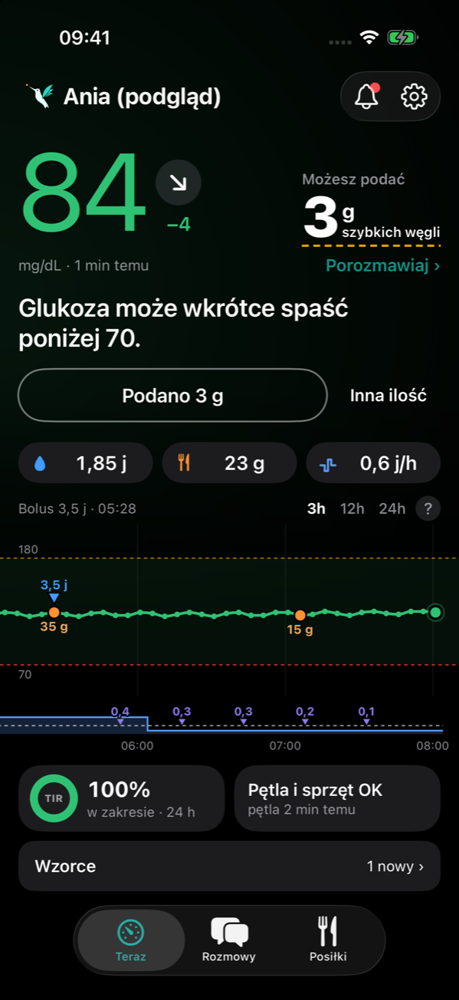
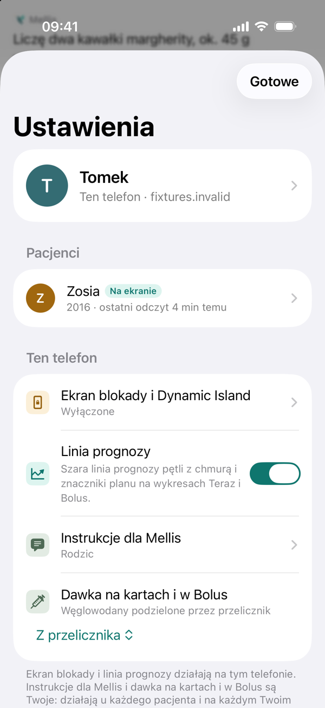
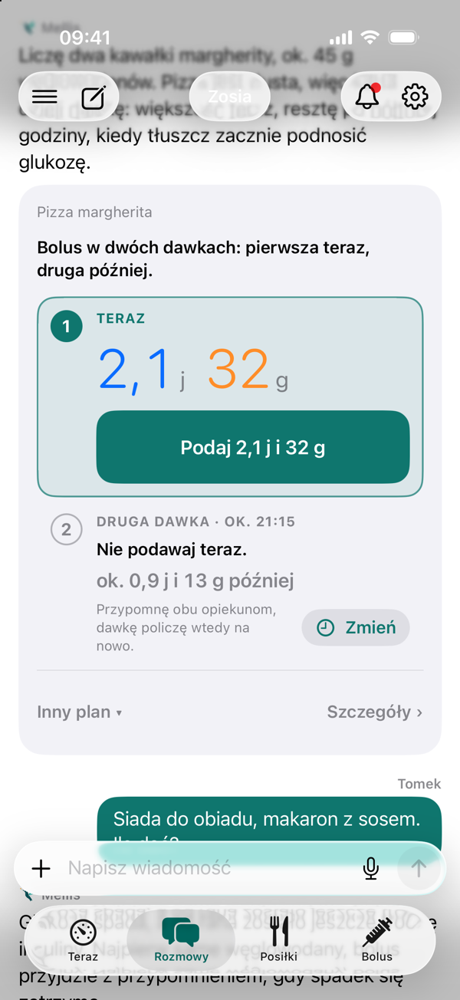
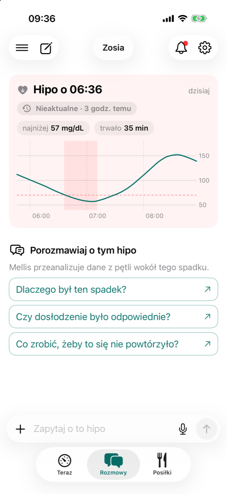
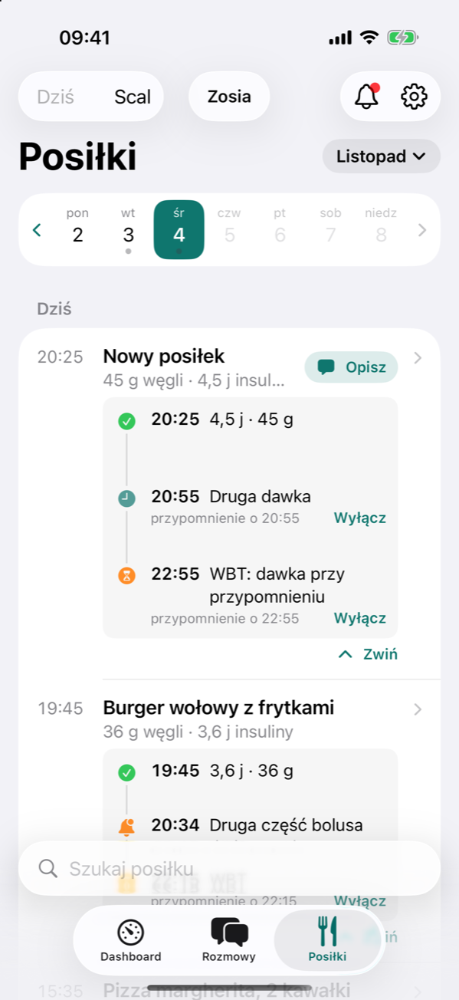
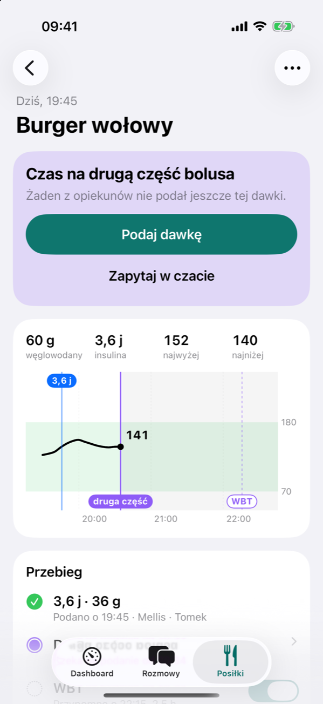
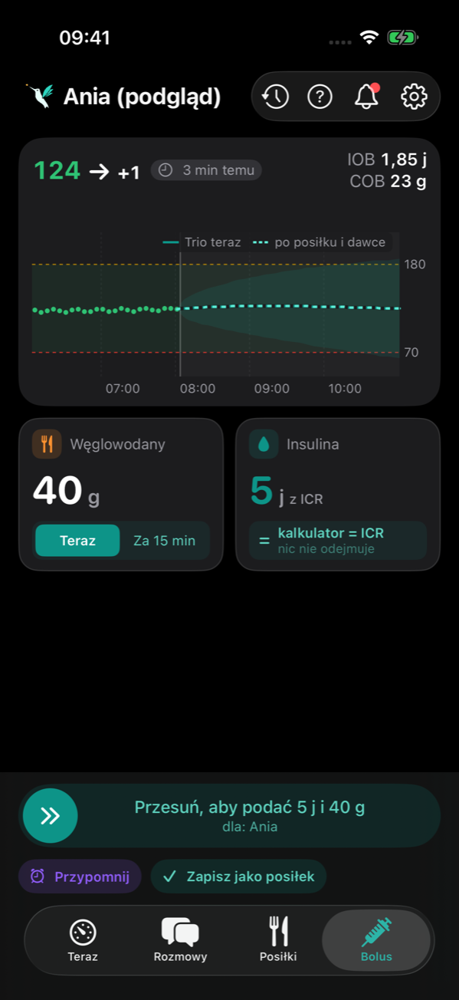

# Co potrafi Mellis

Aplikacja ma karty **Teraz**, **Rozmowy** i **Posiłki**. Opiekun, który ma na swoim telefonie ustawiony
[zdalny bolus](instalacja/zdalny-bolus.md), widzi też kartę **Bolus**.

**Ustawienia** aplikacji Mellis otwierasz ikoną :material-cog-outline: (zębatka) na górnym pasku. W tej instrukcji piszemy
„Mellis → Ustawienia”, żeby nie pomylić ich z Ustawieniami iOS.

## Teraz

Wszystko, co trzeba wiedzieć w tej chwili.

<figure class="clip">
<video controls muted playsinline preload="none" poster="../assets/clips/f-teraz.jpg"><source src="../assets/clips/f-teraz.mp4" type="video/mp4"></video>
<figcaption>Ekran Teraz: glukoza z trendem i zdanie o sytuacji, dymek po dotknięciu ikony insuliny, wykres z 3, 12 i 24 godzin oraz okno „Pętla i sprzęt”. Film 17 s, bez dźwięku, dane przykładowe.</figcaption>
</figure>

- **Glukoza** z trendem, zmianą w 5 minut i czasem od ostatniego odczytu. Po przerwie najnowsza glukoza pojawia się od
  razu, a reszta ekranu doczytuje się obok („Wczytuję dane pompy i pętli…”).
- **Zdanie o sytuacji** pod glukozą mówi, co się teraz dzieje, np. „Od 5 godzin glukoza jest w zakresie.” albo
  „Glukoza może wkrótce spaść poniżej 70.”. Gdy trzeba działać, obok liczby jest ilość węglowodanów („Możesz podać
  3 g szybkich węgli”), a pod zdaniem przyciski **Podano 3 g** i **Inna ilość**:
    - **Podano** zapisuje węglowodany tylko w Mellis (nie w pętli). Przez 5 sekund można to cofnąć przyciskiem
      **Cofnij**, na każdym telefonie.
    - Potem Teraz odlicza czas do sprawdzenia („Kolejne sprawdzenie za 12 min”), a Mellis wysyła powiadomienie z wynikiem.
    - Poniżej 54 mg/dL cały ekran robi się czerwony, z instrukcją podania glukagonu.
    - Gdy najnowszy odczyt ma 70 mg/dL lub więcej i jest o co najmniej 10 wyższy od poprzedniego, Teraz od razu
      przestaje mówić o spadku i proponować węglowodany (także po czerwonym ekranie). Gdy glukoza poniżej 70 wzrośnie
      jednym odczytem o co najmniej 10, do 60–69, a pętla jest w kontakcie, Teraz czeka jeden odczyt: „Glukoza szybko
      rośnie. Mellis sprawdzi następny odczyt o 12:35.”. Powiadomienia o niskiej glukozie się nie zmieniają.
    - Gdy odczyt jest stary, zdanie prosi o pomiar glukometrem.
- **Porozmawiaj ›** otwiera rozmowę, która zaczyna się od tego, co pokazuje Teraz.
- **Trzy ikony** pod zdaniem: kropla to insulina, która jeszcze działa (IOB), sztućce to węglowodany, które jeszcze się
  wchłaniają (COB), a schodek to baza podawana teraz („0,1 j/h, plan 0,25”, gdy pętla zmieniła bazę). Po dotknięciu
  dymek mówi więcej, np. od kiedy jest taka baza i ile było mikrobolusów w ostatniej godzinie.
- **Wykres** na całą szerokość ekranu, który przewijasz palcem w przeszłość:
    - jasnozielone pole to zakres 70–180 mg/dL;
    - na widoku 3 h każdy odczyt jest kropką na linii, a najnowszy większą kropką z pierścieniem (szarzeje po 10 minutach
      bez nowego odczytu);
    - przerwa do 30 minut to szara przerywana linia, dłuższa to szary pas „Brak pomiarów · 1 h 10 min”;
    - bolus to trójkąt z dawką, węglowodany to pomarańczowa kropka z gramami, a węglowodany zapisane tylko w Mellis
      (np. przyciskiem „Podano”) to puste pomarańczowe kółko: pętla ich nie liczy;
    - baza to pas na dole wykresu, dopasowany do planu podopiecznego; szara przerywana linia to baza z profilu, a
      fioletowe trójkąty z liczbami to małe dawki, które pętla podała sama;
    - przytrzymaj palec na wykresie, żeby zobaczyć godzinę, odczyt, bolus, węglowodany i bazę z tamtej chwili;
    - znak **?** nad wykresem objaśnia wszystkie znaki.
- **Linia prognozy**: na prawo od „teraz” szara linia pokazuje prognozę pętli (Trio albo Loopa), a chmura wokół niej jej
  typowy błąd: im szersza, tym mniej pewna. Znaczniki pokazują, co jest w planie: kolejną dawkę, insulinę na WBT,
  zaplanowany posiłek i możliwy późny wzrost po tłustym posiłku. Linię wyłączasz na tym telefonie w **Mellis →
  Ustawienia → Ten telefon → Linia prognozy**. Nie wpływa na dawki ani na alerty.
- Czas w zakresie za 24 godziny, 7 albo 14 dni. Przedziały mają nazwy z liczb („Powyżej 250”, „181–250”, „70–180”,
  „54–69”, „Poniżej 54”), a bardzo niska glukoza liczy się poniżej 54 mg/dL, jak w międzynarodowym konsensusie.
- **Pętla i sprzęt**: czy pętla działa i kiedy ostatnio przysłała dane. Po stuknięciu: ile zostało do wymiany sensora i
  wkłucia oraz na ile wystarczy insuliny w zbiorniku („22 j · na ok. 1 dzień i 20 godz.”, liczone z Twojego średniego
  dziennego zużycia insuliny).
- **Wzorce**: gdy jest coś nowego, wiersz na dole mówi co („Wzorce · Nowe: spadki między 9 a 12 bez jedzenia ›”).
  Więcej niżej, w części [Wzorce](#wzorce).
- **Kilku podopiecznych**: przesuń ekran w bok albo dotknij imienia na górze, żeby przełączyć się na innego
  podopiecznego. Gdy u innego podopiecznego glukoza jest poniżej 70 mg/dL, pod imieniem pojawia się jego imię z
  wartością i strzałką („Kuba 58 ↓”).
- **Przewodnik po ekranie**: przy pierwszym otwarciu Teraz krótki przewodnik pokazuje kolejno zdanie, ikony, wykres,
  znak ?, Wzorce, pętlę i sprzęt oraz przełączanie podopiecznych. Nie pojawia się przy niskiej glukozie ani gdy trzeba
  działać: wtedy czeka do następnego spokojnego otwarcia. Otworzysz go ponownie z dołu legendy pod **?** („Pokaż
  przewodnik po ekranie”) albo w **Mellis → Ustawienia → Pomoc**.
- Widżet na ekranie początkowym i Live Activity na ekranie blokady oraz w Dynamic Island (iOS 18). Przy dwóch
  podopiecznych w **Mellis → Ustawienia → Ten telefon → Ekran blokady i Dynamic Island** wybierasz **Oboje** albo
  **Bliższe zagrożeniu**. Gdy inna aplikacja też ma Live Activity, iOS zmniejsza Mellis do małej bańki: przy „Oboje”
  jest w niej logo Mellis, a przy „Bliższe zagrożeniu” glukoza tego podopiecznego.
- Po powrocie z tła aplikacja otwiera się znów na Teraz. Stuknięte powiadomienie otwiera swój ekran.

<figure class="screen" markdown>
{ loading=lazy }
<figcaption>Ekran Teraz, gdy glukoza może spaść poniżej 70: gramy do podania obok liczby, zdanie o sytuacji, „Podano 3 g” i „Inna ilość”, trzy ikony (insulina, węglowodany, baza), wykres z kropkami odczytów i pasem bazy, czas w zakresie, pętla i sprzęt oraz wiersz Wzorców.</figcaption>
</figure>

<figure class="screen" markdown>
{ loading=lazy }
<figcaption>Mellis → Ustawienia → Ten telefon: przełącznik „Linia prognozy”, włączony od razu, osobno na każdym telefonie, i „Dawka na kartach i w Bolus” (z przelicznika albo z kalkulatora).</figcaption>
</figure>

<figure class="clip">
<video controls muted playsinline preload="none" poster="../assets/clips/f-ostrzezenie.jpg"><source src="../assets/clips/f-ostrzezenie.mp4" type="video/mp4"></video>
<figcaption>Glukoza spada, a prognoza pętli schodzi do 70: Mellis proponuje 3 g szybkich węglowodanów. Potem telefon drugiego opiekuna: „Ania podała 3 g węgli o 13:58.” i czas do sprawdzenia. Film 12 s, bez dźwięku, dane przykładowe.</figcaption>
</figure>

<figure class="clip">
<video controls muted playsinline preload="none" poster="../assets/clips/f-ekran-blokady.jpg"><source src="../assets/clips/f-ekran-blokady.mp4" type="video/mp4"></video>
<figcaption>Live Activity na ekranie blokady: najpierw jeden podopieczny, potem dwoje obok siebie. Film 10 s, bez dźwięku, dane przykładowe.</figcaption>
</figure>

## Rozmowy

Czat z AI, które widzi dane podopiecznego.

<figure class="clip">
<video controls muted playsinline preload="none" poster="../assets/clips/f-czat.jpg"><source src="../assets/clips/f-czat.mp4" type="video/mp4"></video>
<figcaption>Pytanie o pizzę: karta z dawką teraz i kolejną dawką później, a pod „Inny plan” gotowe warianty. Film 11 s, bez dźwięku, dane przykładowe.</figcaption>
</figure>

- Pytania o przeszłość: „Co się działo w nocy?”, „Czemu po obiedzie był skok?”.
- Pytania o teraz: „Ile podać na pizzę?”, „Czy dosłodzić?”. Odpowiedź może zawierać kartę z jednym, najlepszym
  planem, w ponumerowanych krokach: najpierw szybkie węglowodany, gdy trzeba dosłodzić (z przyciskiem **Pomiń**),
  potem dawka **TERAZ**, potem każda dawka na później z godziną, np. **KOLEJNA DAWKA · OK. 18:59** z napisem „Nie podawaj
  teraz.”. Przy podzielonej dawce zdanie nad krokami mówi np. „Bolus w dwóch dawkach: pierwsza teraz, druga później.”
  Przycisk mówi dokładnie, co pójdzie do pętli („Podaj 3 j i 45 g”). Pod **Inny plan ▾** są gotowe inne plany, np.
  **Więcej później**, **Bez podziału** albo **Z kalkulatora · 0,3 j**: po wybraniu Mellis liczy kartę od nowa na
  aktualnych danych. Inne opcje dostaniesz, gdy o nie zapytasz („jakie mam opcje”). Prognoza i wzór są pod
  **Szczegóły ›**. Nieaktualna karta ma przycisk **Przelicz na aktualnych danych**. Szczegóły:
  [Jak Mellis proponuje dawki](codzienne/dawki.md#karta-dawki).
- Jadłospis albo plan zajęć: wyślij zdjęcie albo PDF i stuknij **Dodaj jadłospis**. Mellis zrobi z niego kartę do
  potwierdzenia, a po potwierdzeniu posiłki trafią do karty Posiłki (więcej niżej).
- **Co Mellis pamięta**: zasady miejsca (np. przedszkola) i uwagi o produktach, które zapiszesz przyciskiem
  **Zapamiętaj**. Mellis bierze je pod uwagę przy kolejnych posiłkach i przy czytaniu jadłospisu.
- Zdjęcia i głos: wklejasz zdjęcie albo mówisz zamiast pisać. **Aparat** otwiera się w polu wiadomości, a zrobione
  zdjęcie widać nad polem. Miniatura zdjęcia otwiera je na cały ekran: przybliżasz dwoma palcami albo podwójnym
  stuknięciem, zamykasz przesunięciem w dół.
- Pytania o ustawienia terapii („Jaką bazę ma Janek?”, „Jakie jest ICR o 13:00?”, „Pokaż ICR i ISF razem”) dostają
  kartę z ustawieniami z profilu pętli: wartość teraz albo o podanej godzinie, wszystkie godziny w ciągu doby i sąsiednie
  wartości. Takie odpowiedzi serwer pisze bez AI, więc przychodzą od razu i nic nie kosztują.
- Pytania „co by było, gdyby” („co by było, gdyby ICR wieczorem był 7,5?”, „czemu w zeszłym tygodniu było lepiej?”):
  Mellis odtwarza zmianę na zapisanych decyzjach pętli z ostatnich tygodni i odpowiada kartą (teraz → po zmianie dla
  spadków i wzrostów) albo małą tabelą wariantów. To odtworzenie, nie gwarancja: zmianę ustawień zawsze omów z
  lekarzem.
- Wiedza z dokumentacji Trio i z naszych opracowań wytycznych (np. ISPAD), z odnośnikami do oryginałów: przy odpowiedziach „dlaczego” AI podaje źródła.
- „Przypomnij mi za godzinę…”: AI ustawi przypomnienie.
- Gdy odpowiedź powstaje, jedna linia mówi, co Mellis właśnie robi (np. wyszukuje produkty w DiabCalc) i jakie dane ma
  pod ręką.
- W **Mellis → Ustawienia → Instrukcje dla Mellis** opisujesz siebie i sposób odpowiadania, np. „krótko” albo
  „jestem opiekunem w przedszkolu, nie podaję insuliny”.

<figure markdown>
{ loading=lazy }
<figcaption>Pytanie o tłusty posiłek: karta w krokach. Krok 1 to dawka teraz z przyciskiem, który mówi, co pójdzie do pętli; krok 2 to kolejna dawka z godziną i przyciskiem „Zmień”.</figcaption>
</figure>

<figure markdown>
{ loading=lazy }
<figcaption>Po niedocukrzeniu Mellis pokazuje jego przebieg i podpowiada pytania do rozmowy.</figcaption>
</figure>

## Posiłki

Dziennik posiłków z kalendarzem.

<figure class="clip">
<video controls muted playsinline preload="none" poster="../assets/clips/f-posilki.jpg"><source src="../assets/clips/f-posilki.mp4" type="video/mp4"></video>
<figcaption>Dziennik z kalendarzem, strona posiłku z wykresem glukozy i scalanie dwóch wpisów w jeden posiłek, z przyciskiem „Cofnij”. Film 16 s, bez dźwięku, dane przykładowe.</figcaption>
</figure>

- Opisz posiłek albo zrób zdjęcie: AI policzy węglowodany, białko i tłuszcz. Do produktów z bazy DiabCalc poda ich
  wartości. Gdy ta baza nie odpowiada, AI szacuje produkty samo i oznacza je jako szacunek.
- Strona posiłku: najważniejsze jest na górze (np. „Czas na kolejną dawkę”, a gdy ktoś już podał insulinę,
  bursztynowe ostrzeżenie). Wykres podpisuje dawki, przypomnienia, szczyt i dołek, widać najniższą glukozę, a podane
  dawki, przypomnienia i WBT są na jednej liście **Przebieg**.
- Posiłek bez opisu ma w dzienniku przycisk **Opisz**, który otwiera jego czat.
- Rozmowa o posiłku: dopisujesz, co jeszcze było na talerzu, a szacunek się poprawia.
- Tłuszcz i białko (WBT): przy tłustym posiłku od 25 g węglowodanów Mellis proponuje rozłożenie bolusa, a przy
  mniejszym daje całą dawkę naraz i może przypomnieć o dawce na tłuszcz i białko. Szczegóły:
  [Rozłożony bolus przy tłustym posiłku](codzienne/dawki.md#rozlozony-bolus).
- **Scal**: kilka wpisów, które były jednym posiłkiem (np. obiad i deser dojedzony pół godziny później), łączysz w
  jeden. Przesuń posiłek w prawo albo przytrzymaj go palcem i wybierz **Scal z innymi**, zaznacz
  pozostałe posiłki i stuknij **Scal** na dole. Szczegóły niżej.
- **Usuń**: przesuń posiłek w lewo albo przytrzymaj go palcem i wybierz **Usuń**. Posiłek znika tylko z Mellis: dla pętli jest
  nadal widoczny, więc nadal liczy jego węglowodany i insulinę. Przypomnienia tego posiłku nie przyjdą. Jeśli czeka na kolejną dawkę, Mellis
  zapyta najpierw, czy na pewno.
- **Cofnij**: po usunięciu i po scaleniu masz 10 sekund na **Cofnij** na dole ekranu. Pasek można też ściągnąć w dół:
  zmiana zostaje wtedy od razu i nie da się jej już cofnąć.

<figure class="clip">
<video controls muted playsinline preload="none" poster="../assets/clips/f-wbt.jpg"><source src="../assets/clips/f-wbt.mp4" type="video/mp4"></video>
<figcaption>Po tłustym posiłku przychodzi przypomnienie „WBT: Pizza margherita”. Stuknięcie otwiera propozycję dawki na tłuszcz i białko; decyzję podejmujesz Ty. Film 10 s, bez dźwięku, dane przykładowe.</figcaption>
</figure>

<figure class="clip">
<video controls muted playsinline preload="none" poster="../assets/clips/f-dawka-w-czesciach.jpg"><source src="../assets/clips/f-dawka-w-czesciach.mp4" type="video/mp4"></video>
<figcaption>Przypomnienie „Kolejna dawka · 24 g” otwiera kartę z dawką policzoną od nowa i wyjaśnieniem. Suwak wysyła ją do pętli, a oba telefony widzą „Podano”. Film 12 s, bez dźwięku, dane przykładowe.</figcaption>
</figure>

### Plan posiłków

Posiłki znane z góry, np. z jadłospisu przedszkola albo planu lekcji.

<figure class="clip">
<video controls muted playsinline preload="none" poster="../assets/clips/f-plan.jpg"><source src="../assets/clips/f-plan.mp4" type="video/mp4"></video>
<figcaption>Obiad z jadłospisu przypięty nad listą: gotowa dawka z poprawką na WF. Po zmianie porcji ziemniaków na połowę dawka liczy się od nowa. Film 13 s, bez dźwięku, dane przykładowe.</figcaption>
</figure>

- Plan powstaje w czacie: wysyłasz zdjęcie albo PDF jadłospisu lub planu zajęć (telefon zamienia strony PDF w najwyżej
  trzy zdjęcia), a Mellis robi z niego kartę do potwierdzenia. Nic nie trafia do planu i żadne powiadomienie nie
  przychodzi, dopóki opiekun nie potwierdzi karty.
- W kalendarzu widać posiłki na kolejne dni. Na dziś są w sekcji **Zaplanowane**, a najbliższy posiłek godzinę
  wcześniej przypina się nad listą.
- Każdy zaplanowany posiłek ma swoją stronę. Przy każdym produkcie ustawiasz porcję: całość, połowa, nic, inna ilość
  gramów albo inny produkt. Od 30 minut przed posiłkiem do 30 minut po nim strona pokazuje kartę dawki, taką samą jak w
  czacie, ale tylko gdy posiłek jest nadal w planie i nikt nie podał jeszcze do niego bolusa. Gdy trzeba najpierw dosłodzić, szybkie węglowodany są pierwsze i mają własny przycisk, a węglowodany posiłku
  wpisujesz, gdy zaczyna się jedzenie.
- Strona ma też swój czat: piszesz albo fotografujesz, co się zmieniło („zamiast kisielu batonik”), a Mellis odpowiada
  całym posiłkiem po zmianie. Zatwierdzona zmiana zmienia produkty na wszystkich telefonach.
- Zajęcia (np. WF) to nie posiłek: Mellis przypomni o nich tylko wtedy, gdy glukoza przed nimi jest niska.
- Powiadomienia planu (przełącznik **Przed posiłkami**, osobno na każdym telefonie, domyślnie włączony): przypomnienie przed posiłkiem z aktualną glukozą, jedno
  powiadomienie, gdy po porze posiłku nie było bolusa („Obiad 12:30 bez bolusa”), i pytanie „Czy obiad został
  zjedzony?”, gdy bolus podano, a glukoza nie rośnie. W powiadomieniu nigdy nie ma dawki: liczy ją strona posiłku.
- W ustawieniach powiadomień podopiecznego **Bez przypomnień do…** wstrzymuje powiadomienia planu do wybranego dnia, a
  **Usuń plan** usuwa wszystko, co jeszcze przed Wami.

### Scalanie posiłków

Scalony posiłek ma wszystkie węglowodany, bolusy i przypomnienia zaznaczonych posiłków. Zaczyna się o godzinie
najwcześniejszego z nich. Pozostałe wpisy znikają z dziennika.

- **Opis i wartości.** Gdy opis, zdjęcie albo wartości (węglowodany, białko, tłuszcz) ma tylko jeden z posiłków,
  scalony posiłek je zachowuje. Gdy ten posiłek ma już własne węglowodany, Mellis pyta, czy gramy z pozostałych wpisów
  były już w nich wliczone, czy są dodatkowe. Bez własnej wartości węglowodany z pozostałych wpisów liczą się same. Gdy własny opis albo
  wartości ma więcej niż jeden posiłek, Mellis najpierw pyta. Po scaleniu opis i wartości zostają usunięte i trzeba je
  wpisać od nowa na stronie scalonego posiłku. Ta strona otwiera się sama.
- **WBT.** Wcześniejsze wyliczenia dawki WBT zostają usunięte. Następne wyliczenie bierze pod uwagę cały scalony
  posiłek: wszystkie jego węglowodany, białko i tłuszcz oraz wszystkie podane już dawki. Przypomnienie o WBT zostaje
  jedno i liczy się od początku scalonego posiłku.
- **Rozłożony bolus.** Gdy jeden z posiłków czeka na kolejną część bolusa (albo na kolejną dawkę z karty Bolus), Mellis
  pyta, co dalej:
    - **Zostaw podział**: kolejna część zostaje bez zmian, z tą samą dawką i godziną.
    - **Nowy podział w czacie**: zaplanowana część zostaje pominięta, a Mellis otwiera nową rozmowę z gotowym pytaniem
      o nowy podział dla całego posiłku. Wiadomość nie wysyła się sama: możesz ją poprawić i wysłać.
- Gdy na kolejną część bolusa czeka **więcej niż jeden** z zaznaczonych posiłków, Mellis nie scali ich. Najpierw pomiń
  kolejne części we wszystkich posiłkach poza jednym.
- Scalić można od 2 do 8 posiłków, które zmieszczą się w 4 godzinach (tyle obejmuje wykres na stronie posiłku). Po
  zaznaczeniu pierwszego posiłku te, które wychodzą poza to okno, są wyszarzone i nie da się ich zaznaczyć. Gdy dla któregoś z nich właśnie wysyłana jest dawka,
  spróbuj ponownie po odpowiedzi pętli.

<figure markdown>
{ loading=lazy }
<figcaption>Dziennik z kalendarzem: przypięty najbliższy posiłek z planu, sekcja „Zaplanowane” i posiłki z dziś z węglowodanami i insuliną.</figcaption>
</figure>

<figure markdown>
{ loading=lazy }
<figcaption>Strona posiłku: na górze to, co wymaga uwagi, niżej wykres z podpisanymi dawkami i lista „Przebieg”.</figcaption>
</figure>

## Bolus

Bolus i węglowodany wysłane prosto do Trio albo Loopa. Karta pojawia się po ustawieniu
[zdalnego bolusa](instalacja/zdalny-bolus.md) na tym telefonie. Cały ekran mieści się bez przewijania:

- **Na górze** glukoza i wykres z prognozą pętli. Legenda mówi, co jest czym: linia ciągła to prognoza pętli teraz
  (np. „Trio teraz”), a przerywana to prognoza po wpisanym posiłku i dawce („po posiłku i dawce”). Pod glukozą jest
  jedna linijka, tylko gdy coś wymaga uwagi; stuknij ją, żeby zobaczyć wszystkie ostrzeżenia.
- **Węglowodany**: wpisujesz gramy (najwyżej trzy cyfry). **Teraz | Za 15 min**: przy „Za 15 min” węglowodany trafią do
  pętli z godziną posiłku, a dawka jest liczona na ten moment.
- **Insulina**: po wpisaniu węglowodanów od razu jest dawka z ICR (węglowodany ÷ ICR). **ⓘ** w rogu („Skąd ta dawka”)
  pokazuje całe wyliczenie. Możesz też wpisać własną dawkę.
- **Pod dawką** jest dawka policzona inaczej: z kalkulatora pętli (z aktywną insuliną i trendem), np. „0,8 j ·
  kalkulator, odejmuje aktywną insulinę”. Stuknij ją, a zamieni się z dawką w polu. Gdy kalkulator jeszcze liczy, widać
  „kalkulator liczy… dawka za chwilę”, a gdy obie dawki są równe, „kalkulator = ICR”. Gdy glukoza jest wysoka, w tym
  miejscu może być dawka **z korektą** (połowa korekty, najwyżej 1 j). Szczegóły:
  [Jak Mellis proponuje dawki](codzienne/dawki.md#dawka-pod-liczba).
- Gdy glukoza jest niska albo zaraz będzie, dawka teraz to 0 j, a najpierw są węglowodany. Dawka przy niskiej glukozie
  wymaga osobnego potwierdzenia przed wysłaniem.
- Gdy serwer nie wyśle bolusa, mówi to okno nad formularzem: „Nic nie zostało wysłane do Trio.”, **Dlaczego?** z
  powodem i liczbami, a przy niskiej glukozie **Najpierw węglowodany**. Telefon wibruje, a gdy karta Bolus nie jest na
  wierzchu, przychodzi powiadomienie. Szczegóły:
  [Ostrzeżenia przed wysłaniem](codzienne/dawki.md#ostrzezenia-przed-wyslaniem).
- **Suwak** wysyła bolus. Dopóki Mellis liczy, suwak mówi „Liczę dawkę…” (po 4 sekundach „Liczę dłużej niż zwykle…”).
  Każde polecenie potwierdzasz Face ID. Pod suwakiem i na ekranie potwierdzenia widać, dla kogo jest dawka.
- **Przypomnij**, pod suwakiem: przypomnienie o dawce na tłuszcz i białko (WBT) albo o kolejnej dawce, o wybranej
  godzinie albo gdy glukoza zacznie rosnąć. Jeśli zmienisz węglowodany posiłku, Mellis zaproponuje przeliczenie kolejnej
  dawki.
- **Zapisz jako posiłek**, obok: bolus z węglowodanami trafia do karty Posiłki. Odznacz je, gdy to nie był posiłek (np.
  korekta z węglowodanami). Gdy ustawisz przypomnienie, pole zostaje zaznaczone, bo przypomnienie należy do posiłku.
- Po wysłaniu karta **Podano** ma przycisk **Opisz posiłek**, który otwiera czat tego posiłku. Gdy taki bolus podano
  mniej niż 3 godziny po większym posiłku, karta ma też przycisk **Do posiłku: …**, który dopisuje bolus do tamtego
  posiłku (z możliwością cofnięcia przez 10 sekund). Linia podanej dawki zostaje na wykresie, dopóki pętla nie policzy
  nowej prognozy.
- Na górnym pasku: historia wysłanych poleceń, **?** (przewodnik po tym ekranie), dzwonek i ustawienia. Przewodnik
  pokazuje się sam przy pierwszym otwarciu karty; do jego końca klawiatura się nie wysuwa.

<figure class="clip">
<video controls muted playsinline preload="none" poster="../assets/clips/f-bolus.jpg"><source src="../assets/clips/f-bolus.mp4" type="video/mp4"></video>
<figcaption>Karta Bolus: 30 g węglowodanów, dawka z ICR i pod nią dawka z kalkulatora pętli. Suwak wysyła bolus, a kroki pokazują, że pętla go przyjęła i podała. Film 14 s, bez dźwięku, dane przykładowe.</figcaption>
</figure>

<figure class="screen" markdown>
{ loading=lazy }
<figcaption>Karta Bolus: glukoza z prognozą pętli, kafelki węglowodanów i insuliny, dawka policzona inaczej pod liczbą, suwak oraz „Przypomnij” i „Zapisz jako posiłek” pod nim.</figcaption>
</figure>

!!! info "Pętla ma ostatnie słowo"
    Trio i Loop same sprawdzają swój maksymalny bolus i limity. Mellis ich nie obejdzie, a jego limity mogą być
    tylko ostrzejsze.

## Apple Watch

Aplikacja na zegarek i komplikacje na tarczy (watchOS 10 lub nowszy) instalują się razem z aplikacją na telefon.

- Glukoza, strzałka trendu, wiek odczytu i wykres z 2 godzin, osobno dla pierwszego i drugiego podopiecznego z Twojej
  listy albo dla obu naraz (komplikacja **Dwie osoby**).
- Zegarek dostaje od telefonu dostęp tylko do odczytu, więc nie trzeba się na nim logować.
- Na watchOS 26 lub nowszym serwer odświeża komplikację po nowym odczycie. Na starszym systemie odświeża się ona według
  harmonogramu watchOS, więc wartość na tarczy może się spóźniać. Wiek odczytu pokazuje, jak jest stara.

Ustawienie krok po kroku: [Apple Watch](instalacja/aplikacja.md#apple-watch).

## Powiadomienia

- **Ostrzeżenie o możliwym niedocukrzeniu** z propozycją węglowodanów, zanim glukoza spadnie poniżej 70 mg/dL. Po
  stuknięciu otwiera się ekran Teraz z gramami i przyciskiem „Podano”. Domyślnie wyłączone: włączasz je na każdym
  telefonie osobno. Mellis czyta tu prognozę pętli (Trio albo Loopa)
  bez dodatkowych korekt i potwierdza ją odczytami z sensora.
- **Powiadomienia o glikemii**: glukoza niska, spadająca, rosnąca, wysoka, bardzo szybka zmiana i brak danych.
  W tytule glukoza w mg/dL i w nawiasie zmiana w 5 minut („❗ 72 mg/dL (−5)”), pod spodem IOB i COB. Domyślnie wyłączone; każdy rodzaj i to, jak często
  wraca (od co 5 minut), ustawiasz na każdym telefonie osobno.
- **Powiadomienia o sprzęcie**: kończąca się insulina w zbiorniku, słaba bateria pompy i zbliżająca się wymiana wkłucia.
- **Przypomnienia** o kolejnej dawce, o dawce na tłuszcz i białko i te ustawione w czacie.
- **Plan posiłków**: przypomnienie przed zaplanowanym posiłkiem, posiłek bez bolusa i pytanie, czy posiłek został
  zjedzony.
- **Wynik sprawdzenia** po „Podano” na ekranie Teraz i **Nowy wzorzec** (Wzorce).
- **„Odpowiedź gotowa”**, gdy AI odpowie na Twoje pytanie, a aplikacja jest zamknięta albo w tle.

Szczegóły: [Powiadomienia](codzienne/powiadomienia.md).

## Wzorce

Dla właściciela podopiecznego na Trio. Raz w nocy Mellis przegląda ostatnie 14 dni i szuka tego, co się powtarza:
spadków o tych samych godzinach bez jedzenia, wzrostów po posiłkach o jednej porze dnia, dokładek, odbić po
dosłodzeniu i godzin, w których pętla nie mogła dodać insuliny. Pokazuje to jako fakty z pytaniem do sprawdzenia i
tym, co warto pokazać w poradni. **Nigdy nie proponuje dawki ani zmiany ustawień.**

<figure class="clip">
<video controls muted playsinline preload="none" poster="../assets/clips/f-wzorce.jpg"><source src="../assets/clips/f-wzorce.mp4" type="video/mp4"></video>
<figcaption>Lista wzorców, karta „Zmiana z 6.11” z porównaniem przed zmianą i po niej oraz wzorzec z pytaniem do sprawdzenia i tym, co pokazać w poradni. Film 17 s, bez dźwięku, dane przykładowe.</figcaption>
</figure>

- Wiersz na ekranie Teraz mówi, co jest nowe; ekran Wzorców otwiera się też z **Mellis → Ustawienia → podopieczny →
  Wzorce**. Wzorzec jest „Nowy”, dopóki go nie otworzysz (każdy opiekun osobno).
- Każdy wzorzec ma dni, w których wystąpił, wykresy „Kiedy” i przycisk **Omów z Mellis**, który otwiera rozmowę o tym
  wzorcu i jego dniach. **Nie dotyczy nas** ukrywa go na 30 dni.
- Zmiana wpisana w Trio dostaje kartę **Zmiana z …**, która porównuje te same godziny 14 dni przed zmianą i po niej:
  wykres średniej glukozy przed (szara linia) i po (zielononiebieska) oraz cztery kafelki z czasem poniżej 54,
  poniżej 70, powyżej 180 i powyżej 250. Wartość „po” jest zielona, gdy jest lepiej, czerwona, gdy gorzej, a szara,
  gdy prawie się nie zmieniła. Karta nie mówi, czy zmiana pomogła: w tych tygodniach mogło się zmienić też co innego.
- **Raport dla poradni** robi 4-stronicowy PDF do pokazania lekarzowi.
- Powiadomienie **Nowy wzorzec** przychodzi najwyżej raz w tygodniu, w niedzielę wieczorem, a jedno rano po nocy z
  glukozą poniżej 54 mg/dL.

Prognoza glukozy (model ostrzegania przed spadkiem) liczy się teraz w tle dla każdego podopiecznego, bez przełącznika w
aplikacji. Nie zmienia żadnego alertu.

## Zgłaszanie problemów

**Ustawienia → Zgłoś problem** przygotowuje raport o błędzie z telefonu i, gdy jesteś właścicielem, także z serwera. Są
w nim wersje, ustawienia techniczne, kody błędów oraz nazwy i godziny zdarzeń. Nie ma w nim imion, glukozy, dawek,
posiłków, rozmów, zdjęć, kluczy ani adresów. Aplikacja sama go nigdzie nie wysyła: czytasz go i decydujesz, komu go
przekazać.

Szczegóły: [Raport o błędzie](pomoc/prywatnosc.md#raport-o-bledzie).
