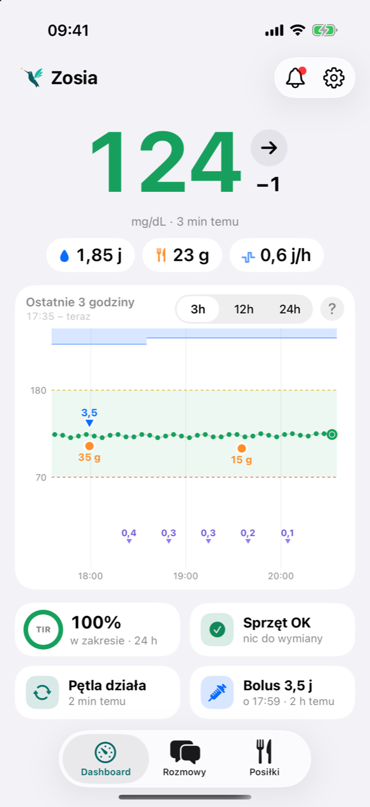
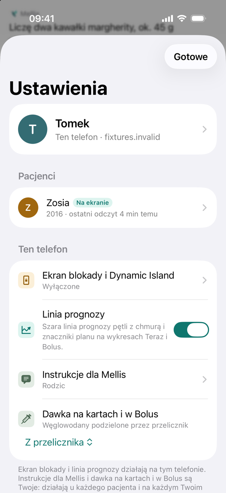
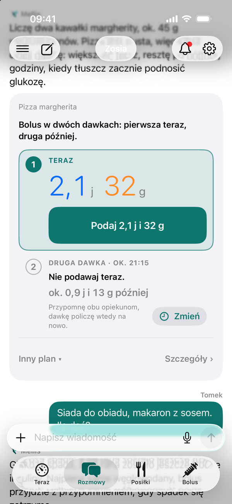
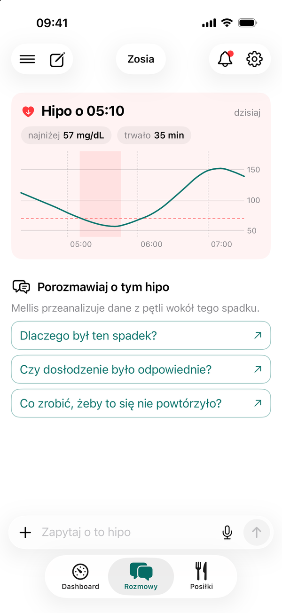
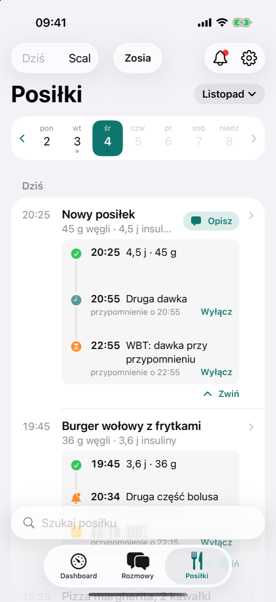
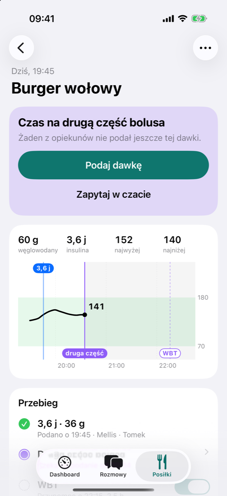
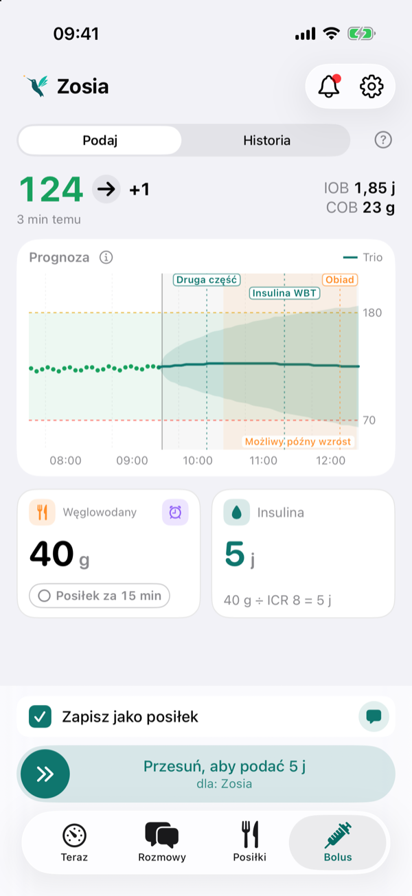

# Co potrafi Mellis

Aplikacja ma karty **Teraz**, **Rozmowy** i **Posiłki**. Opiekun, który ma na swoim telefonie ustawiony
[zdalny bolus](instalacja/zdalny-bolus.md), widzi też kartę **Bolus**.

**Ustawienia** aplikacji Mellis otwierasz ikoną :material-cog-outline: (zębatka) na górnym pasku. W tej instrukcji piszemy
„Mellis → Ustawienia”, żeby nie pomylić ich z Ustawieniami iOS.

## Teraz

Wszystko, co trzeba wiedzieć w tej chwili.

- Glukoza z trendem i czasem od ostatniego odczytu. Ekran otwiera się od razu z ostatnimi danymi zapisanymi w telefonie:
  odczyt młodszy niż 5 minut jest przygaszony, a starszy ustępuje kółku ładowania, dopóki nie przyjdzie nowy.
- Wykres na całą szerokość ekranu, który przewijasz palcem w przeszłość. Jasnozielone pole to zakres 70–180 mg/dL.
  Przytrzymaj palec na wykresie, żeby zobaczyć glukozę, IOB, COB i bazę w danej chwili.
- Na wykresie bolus to trójkąt nad linią glukozy, z dawką, a węglowodany to pomarańczowa kropka pod linią, z gramami.
  Mikrobolusy są na dole. Przy 12 i 24 godzinach bliskie wpisy łączą się w jedną sumę.
- Baza to jasny pas na dole wykresu. Jego wysokość jest dopasowana do planu podopiecznego, więc 0,2 j/h u małego
  dziecka wygląda tak samo jak 1 j/h u dorosłego. Szara przerywana linia to baza z profilu: baza tymczasowa nad nią albo
  pod nią widać od razu.
- **Linia prognozy**: na prawo od „teraz” szara przerywana linia pokazuje prognozę pętli (Trio albo Loopa), a chmura
  wokół niej jej typowy błąd. Znaczniki pokazują, co jest w planie: drugą część bolusa, insulinę na WBT, zaplanowany
  posiłek i czas, gdy po tłustym posiłku glukoza może wzrosnąć później („Możliwy późny wzrost”). Linia jest włączona od
  razu; wyłączasz ją na tym telefonie w **Mellis → Ustawienia → Ten telefon → Linia prognozy**. Nie wpływa na dawki
  ani na alerty.
- Obok glukozy są IOB, COB i baza. Po dotknięciu IOB albo COB dymek mówi, co oznacza ta wartość. Przy bazie widać, ile
  pętla ustawiła teraz i, gdy to coś innego, ile jest w planie („0 j/h z 0,2”). Po dotknięciu dymek mówi, od kiedy tak
  jest, czy plan zmienia nadpisanie i ile było mikrobolusów w ostatniej godzinie.
- Czas w zakresie za 24 godziny, 7 albo 14 dni. Przedziały mają nazwy z liczb („Powyżej 250”, „181–250”, „70–180”,
  „54–69”, „Poniżej 54”), a bardzo niska glukoza liczy się poniżej 54 mg/dL, jak w międzynarodowym konsensusie.
- Przy kilku podopiecznych: dotknij imienia na górze, żeby przełączyć się na innego podopiecznego. Gdy u innego
  podopiecznego glukoza jest poniżej 70 mg/dL, pod imieniem pojawia się jego imię z wartością i strzałką („Kuba 58 ↓”).
- Ile zostało do wymiany sensora i wkłucia oraz na ile wystarczy insuliny w zbiorniku („22 j · na ok. 1 dzień i 20 godz.”,
  liczone z Twojego średniego dziennego zużycia insuliny).
- Widżet na ekranie początkowym i Live Activity na ekranie blokady oraz w Dynamic Island (iOS 18).

<figure class="screen" markdown>
{ loading=lazy }
<figcaption>Ekran Teraz: glukoza z trendem, IOB, COB i baza, wykres z linią prognozy i znacznikami planu, czas w zakresie oraz stan pętli i sprzętu.</figcaption>
</figure>

<figure class="screen" markdown>
{ loading=lazy }
<figcaption>Mellis → Ustawienia → Ten telefon: przełącznik „Linia prognozy”, włączony od razu, osobno na każdym telefonie, i „Dawka na kartach i w Bolus” (z przelicznika albo z kalkulatora).</figcaption>
</figure>

## Rozmowy

Czat z AI, które widzi dane podopiecznego.

- Pytania o przeszłość: „Co się działo w nocy?”, „Czemu po obiedzie był skok?”.
- Pytania o teraz: „Ile podać na pizzę?”, „Czy dosłodzić?”. Odpowiedź może zawierać kartę z jednym, najlepszym
  planem, w ponumerowanych krokach: najpierw szybkie węglowodany, gdy trzeba dosłodzić (z przyciskiem **Pomiń**),
  potem dawka **TERAZ**, potem każda dawka na później z godziną, np. **DRUGA DAWKA · OK. 18:59** z napisem „Nie podawaj
  teraz.”. Przy podzielonej dawce zdanie nad krokami mówi np. „Bolus w dwóch dawkach: pierwsza teraz, druga później.”
  Przycisk mówi dokładnie, co pójdzie do pętli („Podaj 3 j i 45 g”). Pod **Inny plan ▾** są gotowe inne plany, np.
  **Więcej później**, **Bez podziału** albo **Z kalkulatora · 0,3 j**: po wybraniu Mellis liczy kartę od nowa na
  aktualnych danych. Inne opcje dostaniesz, gdy o nie zapytasz („jakie mam opcje”). Prognoza i wzór są pod
  **Szczegóły ›**. Nieaktualna karta ma przycisk **Przelicz na aktualnych danych**. Szczegóły:
  [Jak Mellis proponuje dawki](codzienne/dawki.md#karta-dawki).
- Jadłospis albo plan zajęć: wyślij zdjęcie albo PDF i stuknij **Dodaj jadłospis**. Mellis zrobi z niego kartę do
  potwierdzenia, a po potwierdzeniu posiłki trafią do karty Posiłki (więcej niżej).
- **Co Mellis pamięta**: zasady miejsca (np. przedszkola) i uwagi o produktach, które zapiszesz przyciskiem
  **Zapamiętaj**. Mellis bierze je pod uwagę przy kolejnych posiłkach i przy czytaniu jadłospisu.
- Zdjęcia i głos: wklejasz zdjęcie albo mówisz zamiast pisać.
- Wiedza z dokumentacji Trio i z naszych opracowań wytycznych (np. ISPAD), z odnośnikami do oryginałów: przy odpowiedziach „dlaczego” AI podaje źródła.
- „Przypomnij mi za godzinę…”: AI ustawi przypomnienie.
- Gdy odpowiedź powstaje, jedna linia mówi, co Mellis właśnie robi (np. wyszukuje produkty w DiabCalc) i jakie dane ma
  pod ręką.
- W **Mellis → Ustawienia → Instrukcje dla Mellis** opisujesz siebie i sposób odpowiadania, np. „krótko” albo
  „jestem opiekunem w przedszkolu, nie podaję insuliny”.

<figure markdown>
{ loading=lazy }
<figcaption>Pytanie o tłusty posiłek: karta w krokach. Krok 1 to dawka teraz z przyciskiem, który mówi, co pójdzie do pętli; krok 2 to druga dawka z godziną i przyciskiem „Zmień”.</figcaption>
</figure>

<figure markdown>
{ loading=lazy }
<figcaption>Po niedocukrzeniu Mellis pokazuje jego przebieg i podpowiada pytania do rozmowy.</figcaption>
</figure>

## Posiłki

Dziennik posiłków z kalendarzem.

- Opisz posiłek albo zrób zdjęcie: AI policzy węglowodany, białko i tłuszcz. Do produktów z bazy DiabCalc poda ich
  wartości. Gdy ta baza nie odpowiada, AI szacuje produkty samo i oznacza je jako szacunek.
- Strona posiłku: najważniejsze jest na górze (np. „Czas na drugą część bolusa”, a gdy ktoś już podał insulinę,
  bursztynowe ostrzeżenie). Wykres podpisuje dawki, przypomnienia, szczyt i dołek, widać najniższą glukozę, a podane
  dawki, przypomnienia i WBT są na jednej liście **Przebieg**.
- Posiłek bez opisu ma w dzienniku przycisk **Opisz**, który otwiera jego czat.
- Rozmowa o posiłku: dopisujesz, co jeszcze było na talerzu, a szacunek się poprawia.
- Tłuszcz i białko (WBT): przy tłustym posiłku od 25 g węglowodanów Mellis proponuje rozłożenie bolusa, a przy
  mniejszym daje całą dawkę naraz i może przypomnieć o dawce na tłuszcz i białko. Szczegóły:
  [Rozłożony bolus przy tłustym posiłku](codzienne/dawki.md#rozlozony-bolus).
- **Scal**: kilka wpisów, które były jednym posiłkiem (np. obiad i deser dojedzony pół godziny później), łączysz w
  jeden. Przesuń posiłek w prawo albo przytrzymaj go palcem i wybierz **Scal z innymi**, zaznacz
  pozostałe posiłki i stuknij **Scal** na dole. Szczegóły niżej.
- **Usuń**: przesuń posiłek w lewo albo przytrzymaj go palcem i wybierz **Usuń**. Posiłek znika tylko z Mellis: dla pętli jest
  nadal widoczny, więc nadal liczy jego węglowodany i insulinę. Przypomnienia tego posiłku nie przyjdą. Jeśli czeka na drugą część bolusa, Mellis
  zapyta najpierw, czy na pewno.
- **Cofnij**: po usunięciu i po scaleniu masz 10 sekund na **Cofnij** na dole ekranu. Pasek można też ściągnąć w dół:
  zmiana zostaje wtedy od razu i nie da się jej już cofnąć.

### Plan posiłków

Posiłki znane z góry, np. z jadłospisu przedszkola albo planu lekcji.

- Plan powstaje w czacie: wysyłasz zdjęcie albo PDF jadłospisu lub planu zajęć (telefon zamienia strony PDF w najwyżej
  trzy zdjęcia), a Mellis robi z niego kartę do potwierdzenia. Nic nie trafia do planu i żadne powiadomienie nie
  przychodzi, dopóki opiekun nie potwierdzi karty.
- W kalendarzu widać posiłki na kolejne dni. Na dziś są w sekcji **Zaplanowane**, a najbliższy posiłek godzinę
  wcześniej przypina się nad listą.
- Każdy zaplanowany posiłek ma swoją stronę. Przy każdym produkcie ustawiasz porcję: całość, połowa, nic, inna ilość
  gramów albo inny produkt. Od 30 minut przed posiłkiem do 30 minut po nim strona pokazuje kartę dawki, taką samą jak w
  czacie, ale tylko gdy posiłek jest nadal w planie i nikt nie podał jeszcze do niego bolusa. Gdy trzeba najpierw dosłodzić, szybkie węglowodany są pierwsze i mają własny przycisk, a węglowodany posiłku
  wpisujesz, gdy zaczyna się jedzenie.
- Strona ma też swój czat: piszesz albo fotografujesz, co się zmieniło („zamiast kisielu batonik”), a Mellis odpowiada
  całym posiłkiem po zmianie. Zatwierdzona zmiana zmienia produkty na wszystkich telefonach.
- Zajęcia (np. WF) to nie posiłek: Mellis przypomni o nich tylko wtedy, gdy glukoza przed nimi jest niska.
- Powiadomienia planu (przełącznik **Przed posiłkami**, osobno na każdym telefonie, domyślnie włączony): przypomnienie przed posiłkiem z aktualną glukozą, jedno
  powiadomienie, gdy po porze posiłku nie było bolusa („Obiad 12:30 bez bolusa”), i pytanie „Czy obiad został
  zjedzony?”, gdy bolus podano, a glukoza nie rośnie. W powiadomieniu nigdy nie ma dawki: liczy ją strona posiłku.
- W ustawieniach powiadomień podopiecznego **Bez przypomnień do…** wstrzymuje powiadomienia planu do wybranego dnia, a
  **Usuń plan** usuwa wszystko, co jeszcze przed Wami.

### Scalanie posiłków

Scalony posiłek ma wszystkie węglowodany, bolusy i przypomnienia zaznaczonych posiłków. Zaczyna się o godzinie
najwcześniejszego z nich. Pozostałe wpisy znikają z dziennika.

- **Opis i wartości.** Gdy opis, zdjęcie albo wartości (węglowodany, białko, tłuszcz) ma tylko jeden z posiłków,
  scalony posiłek je zachowuje. Gdy ten posiłek ma już własne węglowodany, Mellis pyta, czy gramy z pozostałych wpisów
  były już w nich wliczone, czy są dodatkowe. Bez własnej wartości węglowodany z pozostałych wpisów liczą się same. Gdy własny opis albo
  wartości ma więcej niż jeden posiłek, Mellis najpierw pyta. Po scaleniu opis i wartości zostają usunięte i trzeba je
  wpisać od nowa na stronie scalonego posiłku. Ta strona otwiera się sama.
- **WBT.** Wcześniejsze wyliczenia dawki WBT zostają usunięte. Następne wyliczenie bierze pod uwagę cały scalony
  posiłek: wszystkie jego węglowodany, białko i tłuszcz oraz wszystkie podane już dawki. Przypomnienie o WBT zostaje
  jedno i liczy się od początku scalonego posiłku.
- **Rozłożony bolus.** Gdy jeden z posiłków czeka na kolejną część bolusa (albo na drugą dawkę z karty Bolus), Mellis
  pyta, co dalej:
    - **Zostaw podział**: kolejna część zostaje bez zmian, z tą samą dawką i godziną.
    - **Nowy podział w czacie**: zaplanowana część zostaje pominięta, a Mellis otwiera nową rozmowę z gotowym pytaniem
      o nowy podział dla całego posiłku. Wiadomość nie wysyła się sama: możesz ją poprawić i wysłać.
- Gdy na kolejną część bolusa czeka **więcej niż jeden** z zaznaczonych posiłków, Mellis nie scali ich. Najpierw pomiń
  kolejne części we wszystkich posiłkach poza jednym.
- Scalić można od 2 do 8 posiłków, które zmieszczą się w 4 godzinach (tyle obejmuje wykres na stronie posiłku). Po
  zaznaczeniu pierwszego posiłku te, które wychodzą poza to okno, są wyszarzone i nie da się ich zaznaczyć. Gdy dla któregoś z nich właśnie wysyłana jest dawka,
  spróbuj ponownie po odpowiedzi pętli.

<figure markdown>
{ loading=lazy }
<figcaption>Dziennik z kalendarzem: przypięty najbliższy posiłek z planu, sekcja „Zaplanowane” i posiłki z dziś z węglowodanami i insuliną.</figcaption>
</figure>

<figure markdown>
{ loading=lazy }
<figcaption>Strona posiłku: na górze to, co wymaga uwagi, niżej wykres z podpisanymi dawkami i lista „Przebieg”.</figcaption>
</figure>

## Bolus

Bolus i węglowodany wysłane prosto do Trio albo Loopa. Karta pojawia się po ustawieniu
[zdalnego bolusa](instalacja/zdalny-bolus.md) na tym telefonie.

- Wpisujesz węglowodany, a Mellis liczy dawkę z ustawień pętli i pokazuje prognozę glukozy na wykresie.
  Wykres to prognoza Twojej pętli (Trio albo Loopa), bez dodatkowych korekt. Pętla nie wie jeszcze o dawce, której
  nie podałeś, więc linia (podpisana nazwą pętli, np. „Trio”) jest **bez tej dawki**; ⓘ przy „Prognoza” to wyjaśnia. Dawkę Mellis sprawdza osobno: do prognozy
  pętli dodaje pełne działanie wpisanych węglowodanów i insuliny (z ISF i ICR) i ostrzega, gdy wynik spada
  poniżej 70 mg/dL. Na wykresie są też znaczniki planu (druga część, insulina na WBT, zaplanowany posiłek), tak jak na
  ekranie Teraz.
- „Posiłek za 15 min”: węglowodany wchodzą do pętli z opóźnieniem, a bolus jest liczony na moment posiłku.
- Dawka zaczyna się od przelicznika (węglowodany / ICR). Kalkulator, który odejmuje insulinę z poprzednich bolusów i
  patrzy na trend, możesz wybrać w **Mellis → Ustawienia → Ten telefon → Dawka na kartach i w Bolus**. Drugą dawkę
  wstawia przełącznik w rogu pola insuliny. Mellis sam nie wpisuje więcej niż dawka z przelicznika.
- Gdy glukoza jest niska albo zaraz będzie, dawka teraz to 0 j, a najpierw są węglowodany. Bolus możesz odłożyć:
  Mellis przypomni o nim, gdy glukoza przestanie spadać. Szczegóły: [Jak Mellis proponuje dawki](codzienne/dawki.md).
- Druga część rozłożonego bolusa: Mellis przypomni o niej o wybranej godzinie albo gdy glukoza zacznie rosnąć.
  Jeśli zmienisz węglowodany posiłku, zaproponuje przeliczenie kolejnej części.
- **„Zapisz jako posiłek”** jest zaznaczone od razu: bolus z węglowodanami trafia do karty Posiłki. Odznacz je, gdy
  to nie był posiłek (np. korekta z węglowodanami). Gdy ustawisz przypomnienie, pole zostaje zaznaczone, bo
  przypomnienie należy do posiłku.
- Po takim bolusie karta **Podano** ma przycisk **Opisz posiłek**, który otwiera czat tego posiłku. Po zatwierdzeniu
  czat sam się zamyka, a karta pokazuje „Posiłek utworzony: …”.
- Gdy taki bolus podano mniej niż 3 godziny po większym posiłku, karta ma też przycisk **Do posiłku: …**. Po
  potwierdzeniu dopisuje on bolus do tamtego posiłku, a karta pokazuje „Dopisane do: …”. Gdy tamten posiłek ma już własne
  węglowodany, karta pyta, czy gramy z tego bolusa były w nich już wliczone. Przez 10 sekund można to cofnąć małym
  przyciskiem **Cofnij** na karcie. Oba potwierdzenia otwierają
  stronę posiłku.
- Karta otwiera się od razu z glukozą zapisaną w telefonie (przygaszoną, gdy jest młodsza niż 5 minut). Suwak czeka na
  sprawdzenie dawki na serwerze. Pociągnięcie w dół wczytuje wszystko od nowa.
- Każde polecenie potwierdzasz Face ID. Pod suwakiem i na ekranie potwierdzenia widać, dla kogo jest dawka.

<figure class="screen" markdown>
{ loading=lazy }
<figcaption>Karta Bolus: wpisujesz węglowodany, Mellis liczy dawkę i pokazuje prognozę Trio bez tej dawki ze znacznikami planu. Pod suwakiem widać, dla kogo jest dawka.</figcaption>
</figure>

!!! info "Pętla ma ostatnie słowo"
    Trio i Loop same sprawdzają swój maksymalny bolus i limity. Mellis ich nie obejdzie, a jego limity mogą być
    tylko ostrzejsze.

## Apple Watch

Aplikacja na zegarek i komplikacje na tarczy (watchOS 10 lub nowszy) instalują się razem z aplikacją na telefon.

- Glukoza, strzałka trendu, wiek odczytu i wykres z 2 godzin, osobno dla pierwszego i drugiego podopiecznego z Twojej
  listy albo dla obu naraz (komplikacja **Dwie osoby**).
- Zegarek dostaje od telefonu dostęp tylko do odczytu, więc nie trzeba się na nim logować.
- Na watchOS 26 lub nowszym serwer odświeża komplikację po nowym odczycie. Na starszym systemie odświeża się ona według
  harmonogramu watchOS, więc wartość na tarczy może się spóźniać. Wiek odczytu pokazuje, jak jest stara.

Ustawienie krok po kroku: [Apple Watch](instalacja/aplikacja.md#apple-watch).

## Powiadomienia

- **Ostrzeżenie o możliwym niedocukrzeniu** z propozycją węglowodanów, zanim glukoza spadnie poniżej 70 mg/dL.
  Domyślnie wyłączone: włączasz je na każdym telefonie osobno. Mellis czyta tu prognozę pętli (Trio albo Loopa)
  bez dodatkowych korekt i potwierdza ją odczytami z sensora.
- **Powiadomienia o glikemii**: glukoza niska, spadająca, rosnąca, wysoka, bardzo szybka zmiana i brak danych.
  W tytule glukoza, strzałka i zmiana, pod spodem IOB i COB. Domyślnie wyłączone; każdy rodzaj i to, jak często
  wraca (od co 5 minut), ustawiasz na każdym telefonie osobno.
- **Powiadomienia o sprzęcie**: kończąca się insulina w zbiorniku, słaba bateria pompy i zbliżająca się wymiana wkłucia.
- **Przypomnienia** o drugiej części bolusa, o dawce na tłuszcz i białko i te ustawione w czacie.
- **Plan posiłków**: przypomnienie przed zaplanowanym posiłkiem, posiłek bez bolusa i pytanie, czy posiłek został
  zjedzony.
- **„Odpowiedź gotowa”**, gdy AI odpowie na Twoje pytanie, a aplikacja jest zamknięta albo w tle.

Szczegóły: [Powiadomienia](codzienne/powiadomienia.md).

## Funkcje eksperymentalne

W **Mellis → Ustawienia → podopieczny → Funkcje eksperymentalne** właściciel podopiecznego może włączyć **Prognozę
glukozy**. Nowy model ostrzegania przed spadkiem poniżej 70 mg/dL liczy się wtedy w tle obok obecnych reguł i nie
zmienia żadnego alertu. Po 2–4 tygodniach pod przełącznikiem pojawia się porównanie obu sposobów na danych tego
podopiecznego: ile spadków każdy przewidział, ile alertów dziennie by dawał i ile z nich byłoby bez spadku. Właściciele
dostają jedno powiadomienie, gdy wynik jest gotowy, a przycisk **Skopiuj wynik** pozwala go przekazać dalej. Do
porównania potrzebne są ostrzeżenia o możliwym niedocukrzeniu włączone na co najmniej jednym telefonie opiekuna.
Funkcję można wyłączyć w każdej chwili.

## Zgłaszanie problemów

**Ustawienia → Zgłoś problem** przygotowuje raport o błędzie z telefonu i, gdy jesteś właścicielem, także z serwera. Są
w nim wersje, ustawienia techniczne, kody błędów oraz nazwy i godziny zdarzeń. Nie ma w nim imion, glukozy, dawek,
posiłków, rozmów, zdjęć, kluczy ani adresów. Aplikacja sama go nigdzie nie wysyła: czytasz go i decydujesz, komu go
przekazać.

Szczegóły: [Raport o błędzie](pomoc/prywatnosc.md#raport-o-bledzie).
