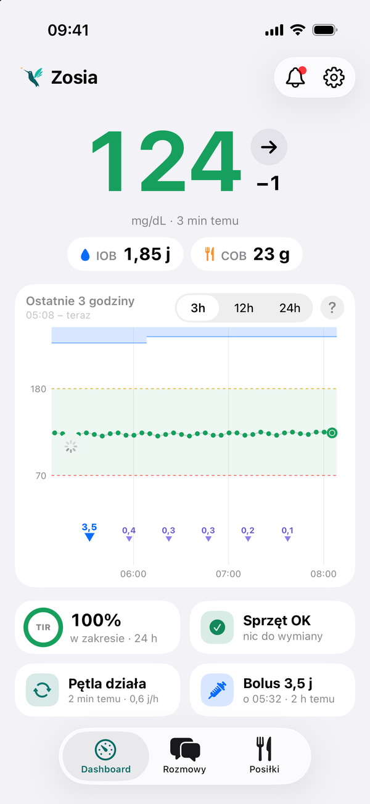
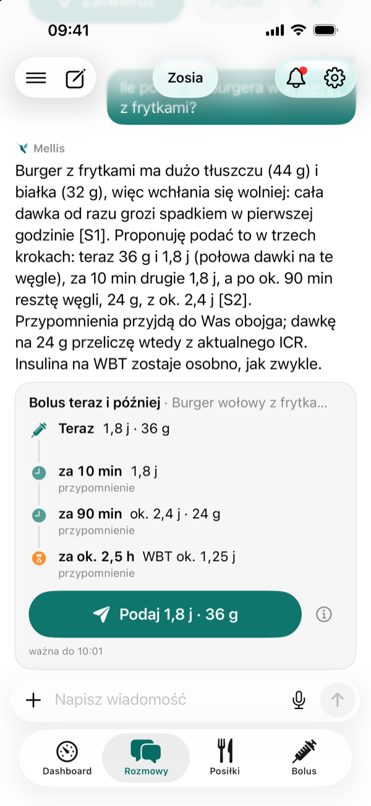
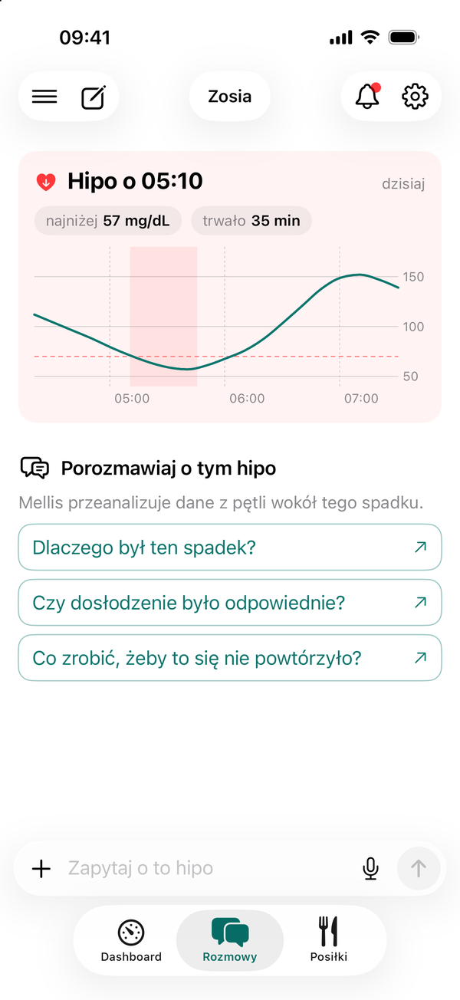
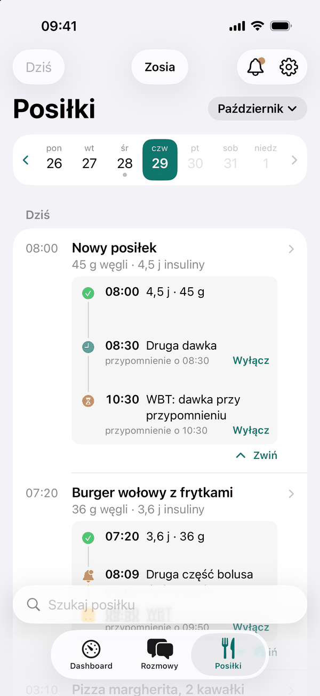
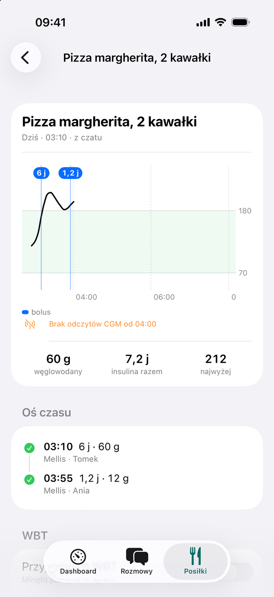
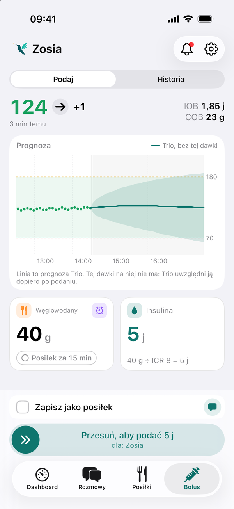

# Co potrafi Mellis

Aplikacja ma karty **Dashboard**, **Rozmowy** i **Posiłki**. Opiekun, który ma na swoim telefonie ustawiony
[zdalny bolus](instalacja/zdalny-bolus.md), widzi też kartę **Bolus**.

**Ustawienia** Mellisa otwierasz ikoną :material-cog-outline: (zębatka) na górnym pasku. W tej instrukcji piszemy
„Mellis → Ustawienia”, żeby nie pomylić ich z Ustawieniami iOS.

## Dashboard

Wszystko, co trzeba wiedzieć w tej chwili.

- Glukoza z trendem i czasem od ostatniego odczytu.
- Wykres, który przewijasz palcem w przeszłość. Przytrzymaj palec na wykresie, żeby zobaczyć IOB, COB i bazę
  w danej chwili.
- Czas w zakresie za 24 godziny, 7 albo 14 dni.
- Ile zostało do wymiany sensora i wkłucia oraz na ile wystarczy insuliny w zbiorniku („22 j · na ok. 2 dni”,
  liczone z Twojego średniego dziennego zużycia insuliny).
- Widżet na ekranie początkowym i Live Activity na ekranie blokady oraz w Dynamic Island (iOS 18).

<figure class="screen" markdown>
{ loading=lazy }
<figcaption>Dashboard: glukoza z trendem, IOB i COB, wykres z bolusami, czas w zakresie, sprzęt, pętla i ostatni bolus.</figcaption>
</figure>

## Rozmowy

Czat z AI, które widzi dane podopiecznego.

- Pytania o przeszłość: „Co się działo w nocy?”, „Czemu po obiedzie był skok?”.
- Pytania o teraz: „Ile podać na pizzę?”, „Czy dosłodzić?”. Odpowiedź może zawierać kartę z propozycją, którą
  wysyłasz jednym stuknięciem.
- Zdjęcia i głos: wklejasz zdjęcie albo mówisz zamiast pisać.
- Wiedza z dokumentacji Trio i z naszych opracowań wytycznych (np. ISPAD), z odnośnikami do oryginałów: przy odpowiedziach „dlaczego” AI podaje źródła.
- „Przypomnij mi za godzinę…”: AI ustawi przypomnienie.
- W **Mellis → Ustawienia → Instrukcje dla Mellisa** opisujesz siebie i sposób odpowiadania, np. „krótko” albo
  „jestem opiekunem w przedszkolu, nie podaję insuliny”.

<figure markdown>
{ loading=lazy }
<figcaption>Pytanie o tłusty posiłek: AI wyjaśnia propozycję, a karta pokazuje dawkę teraz i przypomnienia na później.</figcaption>
</figure>

<figure markdown>
{ loading=lazy }
<figcaption>Po niedocukrzeniu Mellis pokazuje jego przebieg i podpowiada pytania do rozmowy.</figcaption>
</figure>

## Posiłki

Dziennik posiłków z kalendarzem.

- Opisz posiłek albo zrób zdjęcie: AI policzy węglowodany, białko i tłuszcz. Do produktów z bazy DiabCalc poda ich
  wartości.
- Rozmowa o posiłku: dopisujesz, co jeszcze było na talerzu, a szacunek się poprawia.
- Tłuszcz i białko (WBT): przy tłustym posiłku Mellis proponuje rozłożenie bolusa i może przypomnieć o dawce na
  tłuszcz i białko.

<figure markdown>
{ loading=lazy }
<figcaption>Dziennik z kalendarzem: każdy posiłek z węglowodanami, insuliną i przypomnieniami o kolejnych dawkach.</figcaption>
</figure>

<figure markdown>
{ loading=lazy }
<figcaption>Strona posiłku: glukoza po posiłku, sumy i oś czasu z tym, kto podał dawkę.</figcaption>
</figure>

## Bolus

Bolus i węglowodany wysłane prosto do Trio albo Loopa. Karta pojawia się po ustawieniu
[zdalnego bolusa](instalacja/zdalny-bolus.md) na tym telefonie.

- Wpisujesz węglowodany, a Mellis liczy dawkę z ustawień pętli i pokazuje prognozę glukozy na wykresie.
  Wykres to prognoza Twojej pętli (Trio albo Loopa), bez dodatkowych korekt. Pętla nie wie jeszcze o dawce, której
  nie podałeś, więc linia jest **bez tej dawki** i tak jest podpisana. Dawkę Mellis sprawdza osobno: do prognozy
  pętli dodaje pełne działanie wpisanych węglowodanów i insuliny (z ISF i ICR) i ostrzega, gdy wynik spada
  poniżej 70 mg/dL.
- „Posiłek za 15 min”: węglowodany wchodzą do pętli z opóźnieniem, a bolus jest liczony na moment posiłku.
- Przy spadającej glukozie Mellis zaproponuje mniejszą dawkę albo bolus później, gdy glukoza przestanie spadać.
- Druga część rozłożonego bolusa: Mellis przypomni o niej o wybranej godzinie albo gdy glukoza zacznie rosnąć.
  Jeśli zmienisz węglowodany posiłku, zaproponuje przeliczenie kolejnej części.
- Każde polecenie potwierdzasz Face ID. Pod suwakiem i na ekranie potwierdzenia widać, dla kogo jest dawka.

<figure class="screen" markdown>
{ loading=lazy }
<figcaption>Karta Bolus: wpisujesz węglowodany, Mellis liczy dawkę i pokazuje prognozę Trio bez tej dawki. Pod suwakiem widać, dla kogo jest dawka.</figcaption>
</figure>

!!! info "Pętla ma ostatnie słowo"
    Trio i Loop same sprawdzają swój maksymalny bolus i limity. Mellis ich nie obejdzie, a jego limity mogą być
    tylko ostrzejsze.

## Powiadomienia

- **Ostrzeżenie o możliwym niedocukrzeniu** z propozycją węglowodanów, zanim glukoza spadnie poniżej 70 mg/dL.
  Domyślnie wyłączone: włączasz je na każdym telefonie osobno. Mellis czyta tu prognozę pętli (Trio albo Loopa)
  bez dodatkowych korekt i potwierdza ją odczytami z sensora.
- **Przypomnienia** o drugiej części bolusa, o dawce na tłuszcz i białko i te ustawione w czacie.
- **„Odpowiedź gotowa”**, gdy AI odpowie na Twoje pytanie, a aplikacja jest zamknięta albo w tle.

Szczegóły: [Powiadomienia](codzienne/powiadomienia.md).
