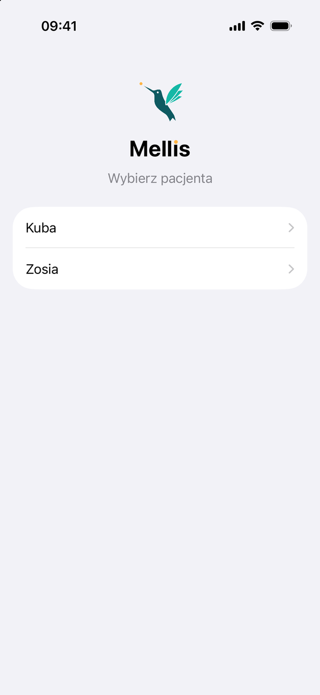

# Opiekunowie i podopieczni

## Kto jest kim

- **Podopieczny** to osoba z cukrzycą, której dane pochodzą z Nightscouta. Może nim być też dorosły używający
  aplikacji Mellis dla siebie.
- **Opiekun** to osoba z aplikacją Mellis połączoną z serwerem. Może opiekować się kilkoma podopiecznymi.
- **Właściciel** to opiekun z uprawnieniem **Zarządza udostępnianiem**: zaprasza innych, nadaje uprawnienia
  i włącza zdalny bolus. Podopieczny może mieć kilku właścicieli, np. oboje rodziców. Ostatniego właściciela nie da
  się usunąć.

## Uprawnienia

| | Glukoza i alarmy | Rozmowy z AI i posiłki | Zdalny bolus | Zarządza udostępnianiem (właściciel) |
|---|:---:|:---:|:---:|:---:|
| Mama | :material-check: | :material-check: | :material-check: | :material-check: |
| Tata | :material-check: | :material-check: | :material-check: | :material-check: |
| Babcia | :material-check: | :material-check: | | |
| Przedszkole | :material-check: | | | |

To tylko przykłady: uprawnienia ustawiasz dowolnie dla każdej osoby, w **Mellis → Ustawienia → Udostępnianie**.
Na jednego podopiecznego przypada najwyżej 10 osób, licząc otwarte zaproszenia.

- **Zdalny bolus** włącza tylko właściciel, a każda osoba potwierdza go Face ID na swoim telefonie. Wymaga też
  uprawnienia „Rozmowy z AI i posiłki”. Gdy je wyłączysz, zdalny bolus też się wyłączy.
- **Usunięcie osoby** albo **odłączenie jej telefonu** odcina dostęp od razu.

## Kilku podopiecznych

Jeden serwer obsłuży całą rodzinę. Każdy podopieczny ma swój Nightscout, swoje ustawienia i swoich opiekunów.

- Przełączasz się strzałką przy imieniu na górze ekranu. Strzałka pojawia się, gdy masz więcej niż jednego
  podopiecznego.
- Gdy telefon dostaje powiadomienia o kilku osobach, tytuł zaczyna się od imienia, np. „Zosia · Możliwe
  niedocukrzenie”.
- Na ekranie bolusa pod suwakiem widać, dla kogo jest dawka. Ekran potwierdzenia z Face ID powtarza imię.

<figure class="screen" markdown>
{ loading=lazy }
<figcaption>Z kilkoma podopiecznymi Mellis po uruchomieniu pyta, czyje dane pokazać.</figcaption>
</figure>

## AI wie, kto pisze

Każdy opiekun może opisać siebie w **Mellis → Ustawienia → Instrukcje dla Mellis**, np. wybrać „Opiekun
w placówce” albo napisać „nie podaję insuliny”. AI odpowiada wtedy inaczej opiekunowi w placówce, a inaczej
rodzicowi.
