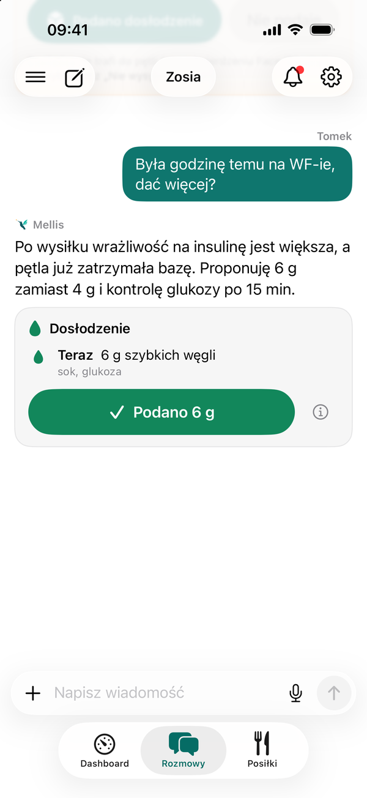
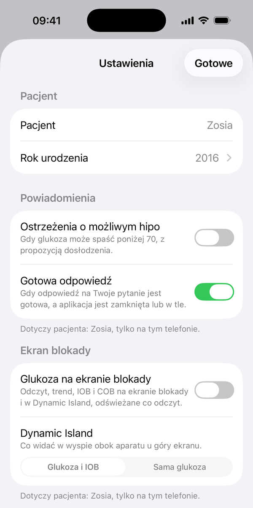

# Powiadomienia

Mellis wysyła powiadomienia z serwera, więc przychodzą także wtedy, gdy aplikacja jest zamknięta.

!!! tip "Przy pierwszym uruchomieniu"
    Gdy iOS zapyta, czy Mellis może wysyłać powiadomienia, wybierz **Zezwól**. Jeśli wybrałeś **Nie zezwalaj**,
    zmienisz to w **Ustawieniach iOS → Powiadomienia → Mellis**.

| Powiadomienie | Kiedy przychodzi | Co zrobić |
|---|---|---|
| **Możliwe niedocukrzenie** (albo **Niedocukrzenie**, **Pilne: niedocukrzenie**) | prognoza pokazuje spadek poniżej 70 mg/dL; tylko jeśli włączyłeś ostrzeżenia na tym telefonie | stuknij: zobaczysz propozycję węglowodanów, którą możesz wysłać albo odrzucić („Nie podaję”) |
| **Druga część bolusa**, **Druga dawka · …** | o ustawionej godzinie albo gdy glukoza zacznie rosnąć, jeśli tak wybrałeś przy dawce | stuknij, sprawdź dawkę i wyślij |
| **Bolus na posiłek** | odłożony bolus: glukoza przestała spadać | stuknij, sprawdź dawkę i wyślij |
| **Przypomnienie o WBT** | ok. 2,5 godziny po tłustym albo białkowym posiłku, jeśli wybrałeś przypomnienie | stuknij i zdecyduj o dawce na tłuszcz i białko |
| **Przypomnienie** | przypomnienie ustawione w czacie | stuknij, żeby wrócić do rozmowy |
| **Mellis potrzebuje odpowiedzi** | AI potrzebuje od Ciebie doprecyzowania, żeby odpowiedzieć | stuknij i odpowiedz |
| **Odpowiedź gotowa** | AI odpowiedziało na Twoje pytanie, a aplikacja jest zamknięta albo w tle | stuknij, żeby przeczytać |
| **Druga dawka podana**, **WBT podane** | inny opiekun podał dawkę, o której było przypomnienie | nic: przypomnienie znika też u Ciebie |

<figure class="screen" markdown>
{ loading=lazy }
<figcaption>Propozycja dosłodzenia w rozmowie. Stuknij „Podano 6 g”, żeby zapisać dosłodzenie albo wysłać je do pętli.</figcaption>
</figure>

!!! info "„Gdy glukoza zacznie rosnąć”"
    Przy rozłożonym albo odłożonym bolusie możesz wybrać przypomnienie o drugiej części „gdy glukoza zacznie rosnąć”.
    Przychodzi, gdy trzy kolejne odczyty z około 10 minut rosną. Serwer pilnuje go przez godzinę: jeśli glukoza w tym
    czasie nie zacznie rosnąć, przypomnienie wygasa bez powiadomienia.

## Co możesz wyłączyć

W **Mellis → Ustawienia → Powiadomienia** są dwa przełączniki. Działają tylko na tym telefonie i tylko dla
wybranego podopiecznego:

- **Ostrzeżenia o możliwym hipo**: domyślnie **wyłączone**. Włącz je na telefonach opiekunów, którzy mają
  reagować, np. tylko u tego, kto jest z podopiecznym.
- **Gotowa odpowiedź**: domyślnie włączone.

<figure class="screen" markdown>
{ loading=lazy }
<figcaption>Mellis → Ustawienia: przełączniki dla wybranego podopiecznego, tylko na tym telefonie.</figcaption>
</figure>

Przypomnień nie wyłączasz osobno: przychodzą tylko wtedy, gdy sam je ustawiłeś. Opiekun z samym uprawnieniem
„Glukoza i alarmy” dostaje tylko ostrzeżenia o glukozie.

Gdy telefon dostaje powiadomienia o kilku podopiecznych, tytuł zaczyna się od imienia, np. „Zosia · Możliwe
niedocukrzenie”.

!!! warning "Mellis nie zastępuje alarmów CGM"
    Powiadomienia Mellisa przechodzą przez serwer, internet i Nightscouta, więc mogą przyjść z opóźnieniem albo
    wcale, np. gdy telefon podopiecznego straci zasięg. Alarmy niskiej glukozy w aplikacji sensora albo w pętli
    zostaw włączone.
