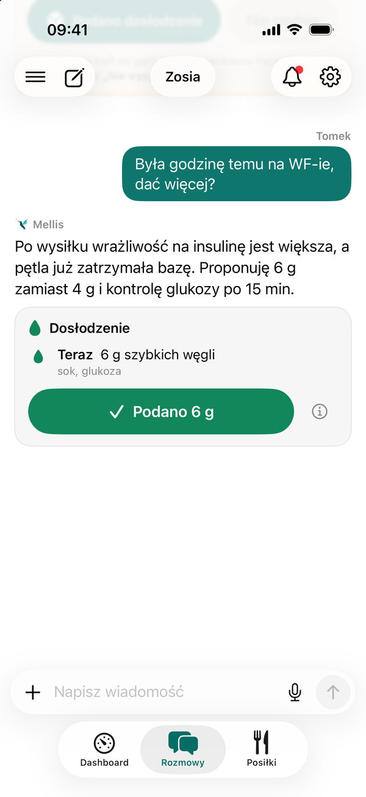
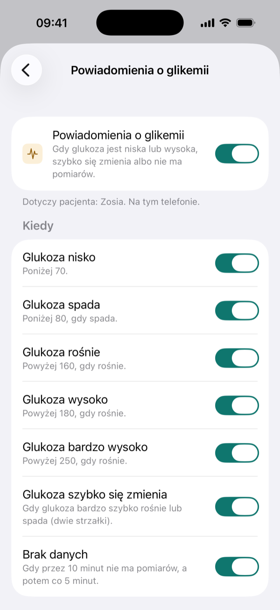
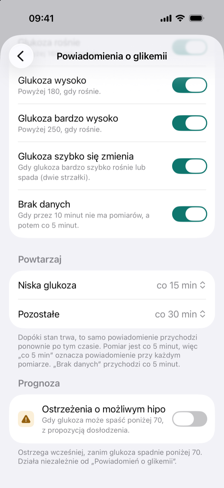
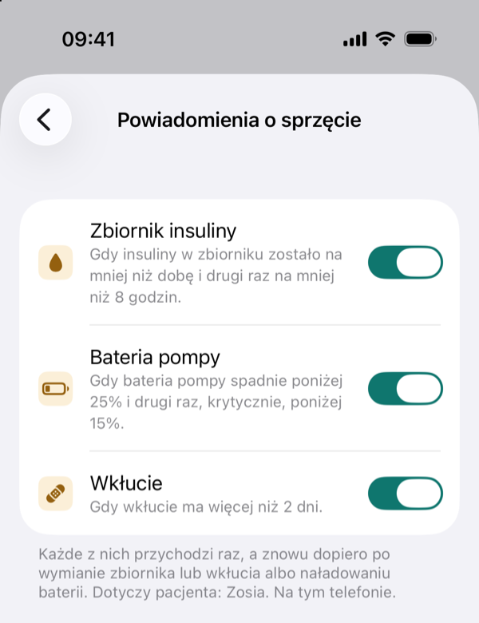
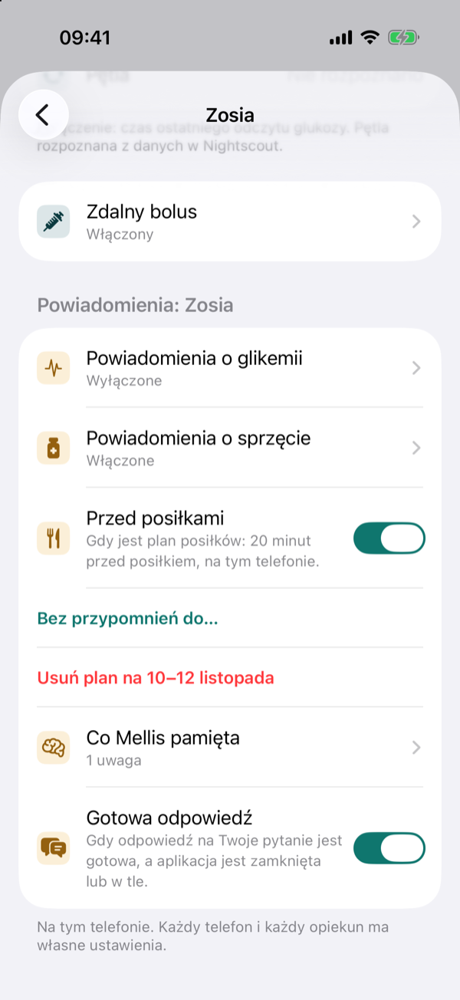

# Powiadomienia

Mellis wysyła powiadomienia z serwera, więc przychodzą także wtedy, gdy aplikacja jest zamknięta.

!!! tip "Przy pierwszym uruchomieniu"
    Gdy iOS zapyta, czy Mellis może wysyłać powiadomienia, wybierz **Zezwól**. Jeśli wybrałeś **Nie zezwalaj**,
    zmienisz to w **Ustawieniach iOS → Powiadomienia → Mellis**.

| Powiadomienie | Kiedy przychodzi | Co zrobić |
|---|---|---|
| **Możliwe niedocukrzenie** (albo **Niedocukrzenie**, **Pilne: niedocukrzenie**) | prognoza pokazuje spadek poniżej 70 mg/dL; tylko jeśli włączyłeś ostrzeżenia na tym telefonie. Treść zaczyna się od obecnej glukozy i jej zmiany w 5 minut, np. „Teraz 95 mg/dL, −4 w 5 min · ok. 14:30 może spaść poniżej 70 · proponuję 3 g” | podaj węglowodany w pętli albo zapisz je kartą w rozmowie; stuknij, żeby zobaczyć wykres, prognozę i wyliczenie dawki |
| **Druga część bolusa**, **Druga dawka · …** | o ustawionej godzinie albo gdy glukoza zacznie rosnąć, jeśli tak wybrałeś przy dawce | stuknij, sprawdź dawkę i wyślij |
| **Bolus na posiłek** | odłożony bolus: glukoza przestała spadać | stuknij, sprawdź dawkę i wyślij |
| **Przypomnienie o WBT** | ok. 2,5 godziny po tłustym albo białkowym posiłku, jeśli wybrałeś przypomnienie | stuknij i zdecyduj o dawce na tłuszcz i białko |
| **Przypomnienie** | przypomnienie ustawione w czacie | stuknij, żeby wrócić do rozmowy |
| **Mellis potrzebuje odpowiedzi** | AI potrzebuje od Ciebie doprecyzowania, żeby odpowiedzieć | stuknij i odpowiedz |
| **Odpowiedź gotowa** | AI odpowiedziało na Twoje pytanie, a aplikacja jest zamknięta albo w tle | stuknij, żeby przeczytać |
| **Kończy się insulina w zbiorniku**, potem **Wymień zbiornik insuliny** | insuliny zostało na mniej niż dobę, a potem na mniej niż 8 godzin średniego zużycia, np. „Insuliny w zbiorniku zostało na ok. 8 godz. (6 j).”; każde raz na napełnienie zbiornika | stuknij, żeby zobaczyć sprzęt; wymień zbiornik albo wkład |
| **❗ 65 −4** (glukoza nisko), **⚠️ 185 +11** (spada / rośnie / wysoko), **⚠️ 140 ⇊ −19** (szybko się zmienia) | powiadomienia o glikemii, jeśli je włączyłeś: tytuł to glukoza i zmiana w 5 minut (strzałka tylko przy szybkiej zmianie), opis mówi, co się dzieje, a pod spodem IOB i COB | sprawdź glukozę i zdecyduj, czy reagować |
| **Brak danych** | przez 10 minut nie przyszedł żaden pomiar, np. „Brak pomiarów od 12 min.”; potem co 5 minut, dopóki nie wróci | sprawdź sensor, telefon z pętlą i Nightscouta |
| **Dziś wymiana wkłucia** albo **Dziś wieczorem wymiana wkłucia** | wkłucie będzie miało 3 dni (od ostatniego wpisu „Site Change” w Nightscoucie), np. „Wkłucie będzie miało 3 dni o 19:40.”, a gdy wypada to w nocy, „Najlepiej zmień je dziś wieczorem.”; raz na wkłucie | zaplanuj wymianę i zapisz ją w pętli |
| **Wkłucie ma już 3 dni** | minęły 3 dni, np. „Założone w poniedziałek o 19:40. Zmień je teraz.”; raz na wkłucie | zmień wkłucie i zapisz zmianę w pętli |
| **Słaba bateria pompy**, potem **Bateria pompy prawie pusta** | bateria pompy poniżej 25 %, a potem poniżej 15 %; każde raz na baterię | wymień baterię |
| **Druga dawka podana**, **WBT podane** | inny opiekun podał dawkę, o której było przypomnienie | nic: przypomnienie znika też u Ciebie |

<figure class="screen" markdown>
{ loading=lazy }
<figcaption>Propozycja dosłodzenia w rozmowie. Stuknij „Podano 6 g”, żeby zapisać dosłodzenie albo wysłać je do pętli.</figcaption>
</figure>

!!! info "Alarm sprzed ponad 30 minut"
    Starszy alarm (albo propozycja dosłodzenia w czacie) ma znaczek **„Nieaktualne · … temu”**, a glukoza przy nim
    jest podpisana **„wtedy:”**, bo to odczyt z chwili alarmu, nie obecny. Z takiego alarmu Mellis nic nie wyśle do
    pętli: prognoza i dawka są sprzed zmiany glukozy. Nadal możesz zapisać, co podano, kartą w rozmowie („Podano
    6 g”). Gdy trzeba dosłodzić teraz, sprawdź aktualną glukozę i wyślij dosłodzenie z karty Posiłki („+” →
    „Dosłodzenie”).

!!! info "Kiedy przychodzi ostrzeżenie i skąd ta dawka"
    Ostrzeżenie przychodzi, gdy glukoza jest poniżej 70 mg/dL albo gdy spadek poniżej 70 w ciągu ok. 30 minut
    potwierdza prognoza. Sam szybki spadek na sensorze potwierdza go dopiero poniżej **110 mg/dL**: wyżej taki spadek
    zwykle wyhamowuje, gdy pętla zatrzyma bazę, więc o ostrzeżeniu decyduje wtedy tylko prognoza.

    Dawka sprowadza najniższy punkt prognozy z najbliższych 30 minut do 90 mg/dL:

    ```text
    dawka = (90 − najniższa prognoza) / (ISF / ICR)
    ```

    ISF / ICR mówi, o ile mg/dL podnosi glukozę 1 g węglowodanów. Wynik jest w granicach od 3 g do 20 g naraz, a
    poniżej 54 mg/dL to co najmniej tyle, ile podnosi glukozę o ok. 70 mg/dL. Węglowodany, które jeszcze się
    wchłaniają (COB), są w prognozie. Po 15 minutach Mellis sprawdza glukozę jeszcze raz i przypomina, jeśli trzeba
    więcej. Liczba węglowodanów, o które prosi Trio (carbsReq), jest tylko informacją: Trio liczy ją na całe
    działanie aktywnej insuliny, a węglowodany w trakcie wchłaniania odejmuje tylko częściowo, więc zwykle wychodzi
    za dużo.

!!! info "Nowa rozmowa po godzinie"
    Gdy otwierasz kartę Rozmowy, a ostatnia rozmowa była cicha od ponad godziny, Mellis pokazuje pustą, nową rozmowę.
    Poprzednia zostaje w liście ☰. Rozmowa otwarta z powiadomienia albo z listy, wiadomość w trakcie pisania i pytanie,
    na które Mellis czeka, zostają na ekranie.

!!! info "„Gdy glukoza zacznie rosnąć”"
    Przy rozłożonym albo odłożonym bolusie możesz wybrać przypomnienie o drugiej części „gdy glukoza zacznie rosnąć”.
    Przychodzi, gdy trzy kolejne odczyty z około 10 minut rosną. Serwer pilnuje go przez godzinę: jeśli glukoza w tym
    czasie nie zacznie rosnąć, przypomnienie wygasa bez powiadomienia.

## Powiadomienia o glikemii

Domyślnie są **wyłączone**. Włączasz je na każdym telefonie osobno: **Mellis → Ustawienia → podopieczny →
Powiadomienia o glikemii**.

| Kiedy | Tytuł | Opis |
|---|---|---|
| glukoza poniżej 70 | **❗ 65 −4** (czerwony wykrzyknik) | Glukoza nisko, spada (albo „rośnie”, albo nic przy zmianie +0) |
| 70–79 i spada | **⚠️ 76 −11** | Glukoza spada |
| przekroczenie 160 (raz), potem powyżej 160 przy wzroście o 5 lub więcej w 5 min | **⚠️ 165 +7** | Glukoza rośnie |
| przekroczenie 180 (raz), potem powyżej 180 przy wzroście o 5 lub więcej w 5 min | **⚠️ 185 +11** | Glukoza wysoko, rośnie |
| powyżej 250 przy wzroście o 5 lub więcej w 5 min | **⚠️ 255 +12** | Glukoza bardzo wysoko, rośnie |
| dwie strzałki (⇈ albo ⇊) | **⚠️ 140 ⇊ −19** | Glukoza szybko spada (albo „szybko rośnie”) |
| powrót do 70–180 po powiadomieniu o glukozie poniżej 70 albo powyżej 180 | **✅ Glukoza w zakresie** | 120 +3 |
| 10 minut bez pomiaru | **Brak danych** | Brak pomiarów od 12 min. |

Tytuł to obecna glukoza i jej zmiana w 5 minut (przy braku zmiany „+0”). Strzałka trendu jest tylko przy szybkiej
zmianie (⇈ albo ⇊). W opisie Mellis dopisuje „rośnie” albo „spada” według tej zmiany, a pod spodem jest linijka
z **IOB i COB**, np. „IOB 1,3 j · COB 15 g”. Powyżej 160 decyduje zmiana w 5 minut (+5 lub więcej), nie strzałka; przekroczenie 160 i 180 przychodzi
zawsze raz, nawet gdy glukoza rośnie wolniej. „Spada” w progu 70–79 Mellis bierze ze strzałki, którą widzisz
w aplikacji. Gdy telefon dostaje powiadomienia o kilku podopiecznych, imię jest w drugiej
linijce, pod glukozą.

- Serwer sprawdza każdy nowy pomiar raz. Na jeden pomiar telefon dostaje najwyżej jedno powiadomienie: najważniejsze
  z tych, które masz włączone (niska glukoza przed szybką zmianą, szybka zmiana przed wysoką glukozą).
- Dopóki stan trwa, to samo powiadomienie wraca po czasie z sekcji **Powtarzaj**. Wyższy próg przychodzi od razu
  (np. z 180 na 250), a niższy nie wraca, dopóki nie minie czas od wyższego.
- **Glukoza w zakresie** przychodzi raz po każdym wyjściu poza zakres, o którym telefon dostał powiadomienie
  („Glukoza nisko”, „Glukoza wysoko”, „Glukoza bardzo wysoko”), gdy pierwszy pomiar wróci do 70–180. Tu tytułem jest
  „✅ Glukoza w zakresie”, a glukoza i zmiana są w opisie.
- **Brak danych** przychodzi po 10 minutach bez pomiaru i potem co 5 minut, dopóki pomiary nie wrócą.
- Nowe powiadomienie o glikemii zastępuje poprzednie na ekranie blokady, więc widzisz tylko obecny stan. Nie trafia
  do dzwonka w aplikacji.
- Żadne powiadomienie Mellis nie przebija się przez tryb skupienia: nie zastępują alarmów sensora ani pętli.

<div class="grid" markdown>

<figure class="screen" markdown>
{ loading=lazy }
<figcaption>Główny przełącznik i każdy rodzaj osobno. Rodzaje możesz ustawić także przy wyłączonym głównym przełączniku.</figcaption>
</figure>

<figure class="screen" markdown>
{ loading=lazy }
<figcaption>Powtarzaj: osobno dla niskiej glukozy i dla pozostałych, od co 5 minut do co godzinę. Niżej ostrzeżenia z prognozy.</figcaption>
</figure>

</div>

## Powiadomienia o sprzęcie

**Mellis → Ustawienia → podopieczny → Powiadomienia o sprzęcie.** Wszystkie trzy są domyślnie włączone.

- **Zbiornik insuliny**: raz, gdy insuliny wystarczy na mniej niż dobę, i drugi raz, gdy na mniej niż 8 godzin —
  wtedy, gdy dashboard pokazuje zbiornik na żółto („wymień dziś”), a potem na czerwono („wymień teraz”).
  Kolejne przyjdą dopiero po napełnieniu zbiornika (wpis „Insulin Change” w Nightscoucie albo wyraźnie więcej
  jednostek w odczycie pompy).
- **Bateria pompy**: raz poniżej 25 % („Słaba bateria pompy”) i raz poniżej 15 % („Bateria pompy prawie pusta”).
  Kolejne przyjdą dopiero po wymianie baterii (wzrost o co najmniej 10 punktów). Potrzebny jest
  procent baterii, który pętla wysyła do Nightscouta; bez niego to powiadomienie nie przyjdzie.

- **Wkłucie**: pory zależą od godziny, o której wkłucie będzie miało 3 dni. Liczy się je od ostatniego wpisu
  „Site Change” w Nightscoucie, który pętla dodaje przy zmianie wkłucia.

    | Wkłucie będzie miało 3 dni | Powiadomienia |
    |---|---|
    | od 9:00 do 22:00 | o 7:00 tego dnia i w chwili, gdy minęły 3 dni |
    | od 7:00 do 9:00 | tylko o 7:00 |
    | przed 7:00 | o 19:00 poprzedniego wieczoru i o 7:00 |
    | po 22:00 | o 19:00 tego wieczoru i o 7:00 następnego dnia |

    Godziny liczą się w strefie czasowej profilu terapii podopiecznego. Po zmianie wkłucia kolejne powiadomienia
    dotyczą już nowego. Od 22:00 do 7:00 Mellis nie wysyła żadnego z nich.
    Gdy ostatni wpis ma ponad 7 dni, Mellis zakłada, że zmiany nie zapisano, i nie wysyła powiadomienia.

Odczyt pompy starszy niż 6 godzin nie wywołuje powiadomienia. Stuknięcie otwiera listę sprzętu na dashboardzie.

<figure class="screen" markdown>
{ loading=lazy }
<figcaption>Zbiornik insuliny, bateria pompy i wkłucie, każde z własnym przełącznikiem.</figcaption>
</figure>

!!! info "Skąd Mellis wie, na ile wystarczy insuliny"
    Serwer liczy średnie dzienne zużycie insuliny (bolusy, w tym zdalne i ręczne, SMB i podana baza z bazami
    tymczasowymi) z ostatnich do 7 pełnych dni. Pomija dni z luką w danych (ponad 6 godzin bez żadnego wpisu
    insuliny) i potrzebuje co najmniej 2 takich dni. Bez tego kolor zbiornika zależy od procentu napełnienia
    (żółty poniżej 15 %, czerwony poniżej 7 %), a gdy i tego nie wiadomo, od 25 i 10 jednostek.

## Co możesz wyłączyć

W **Mellis → Ustawienia → podopieczny** jest sekcja **Powiadomienia**. Wszystko w niej działa tylko na tym telefonie
i tylko dla tego podopiecznego; każdy opiekun ustawia swój telefon sam.

- **Powiadomienia o glikemii** (ekran): domyślnie **wyłączone**; główny przełącznik, rodzaje, powtarzanie.
- **Ostrzeżenia o możliwym hipo** (na tym samym ekranie, w sekcji „Prognoza”): domyślnie **wyłączone**, działają
  niezależnie od głównego przełącznika. Włącz je na telefonach opiekunów, którzy mają reagować. Wyłączenie obejmuje
  cały telefon, także po ponownej instalacji aplikacji.
- **Powiadomienia o sprzęcie** (ekran): zbiornik, bateria pompy i wkłucie, domyślnie włączone.
- **Gotowa odpowiedź**: domyślnie włączone.

<figure class="screen" markdown>
{ loading=lazy }
<figcaption>Mellis → Ustawienia → podopieczny: dwa ekrany powiadomień i „Gotowa odpowiedź”, tylko na tym telefonie.</figcaption>
</figure>

Na telefonie bez internetu powiadomienia nie przyjdą, w tym „Brak danych”: wysyła je serwer.

Przypomnień nie wyłączasz osobno: przychodzą tylko wtedy, gdy sam je ustawiłeś. Opiekun z samym uprawnieniem
„Glukoza i alarmy” dostaje tylko powiadomienia o glukozie i o sprzęcie.

Gdy telefon dostaje powiadomienia o kilku podopiecznych, tytuł zaczyna się od imienia, np. „Zosia · Możliwe
niedocukrzenie”. Powiadomienia o glikemii mają imię w drugiej linijce, pod glukozą.

!!! warning "Mellis nie zastępuje alarmów CGM"
    Powiadomienia z aplikacji Mellis przechodzą przez serwer, internet i Nightscouta, więc mogą przyjść z opóźnieniem albo
    wcale, np. gdy telefon podopiecznego straci zasięg. Alarmy niskiej glukozy w aplikacji sensora albo w pętli
    zostaw włączone.
