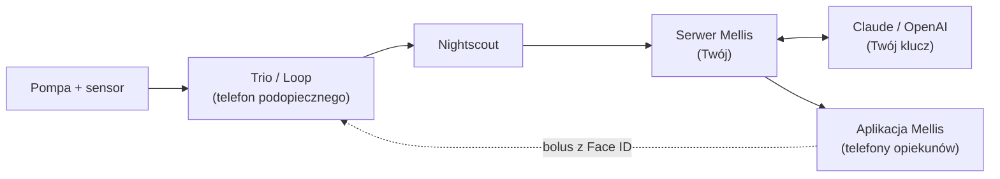

# Instalacja

Całość zajmuje zwykle **około godziny**, z czego sporo to czekanie, aż coś się pobierze albo zbuduje. Nie
musisz znać się na serwerach: serwer i aplikację instalujesz jedną komendą każde, a skrypty pytają o resztę.

Komendy wpisujesz w **Terminalu** na Macu. Przy każdej komendzie piszemy, gdzie ją wkleić: **na Macu** czy **na
serwerze**.

1.  **[Zbierz, czego potrzebujesz](przygotowanie.md)** 20-30 min

    Serwer, klucze i token, z instrukcją krok po kroku dla każdego. Jeśli masz Trio, część już masz.

2.  **[Zainstaluj serwer](serwer.md)** 15 min

    Jedna komenda na serwerze. Instalator zapyta o Nightscout, klucz AI i klucz powiadomień.

3.  **[Zainstaluj aplikację](aplikacja.md)** 15 min

    Jedna komenda na Macu. Aplikacja zbuduje się i zainstaluje na Twoim iPhonie, kablem albo przez Wi-Fi.

4.  **[Połącz telefon z serwerem](parowanie.md)** 1 min

    Twój telefon łączy się sam. Kolejnych opiekunów zapraszasz kodem QR.

5.  **[Włącz zdalny bolus](zdalny-bolus.md)** 5 min, opcjonalnie

    Jeśli chcesz wysyłać bolus do Trio albo Loopa z aplikacji Mellis.

!!! tip "Zrób to na spokojnie"
    Nie instaluj w trakcie posiłku ani wieczorem, gdy trzeba pilnować glukozy. Mellis nie zmienia niczego w Trio
    ani w Loopie, dopóki sam nie wyślesz polecenia, ale lepiej mieć głowę wolną.

## Jak to działa

- **Serwer Mellis** co kilkanaście sekund pobiera dane z Nightscouta, liczy prognozy, wysyła powiadomienia
  i rozmawia z AI. Działa całą dobę, dlatego jest na serwerze, a nie na telefonie.
- **Aplikacja** pokazuje dane i wysyła bolus **bezpośrednio do Trio albo Loopa**, przez powiadomienia Apple, tak
  samo jak Loop Follow. Serwer nie może sam podać bolusa.
