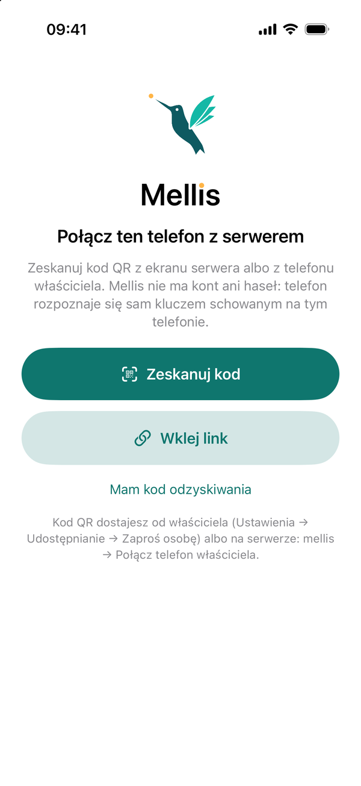
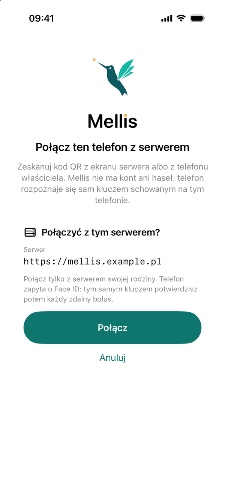
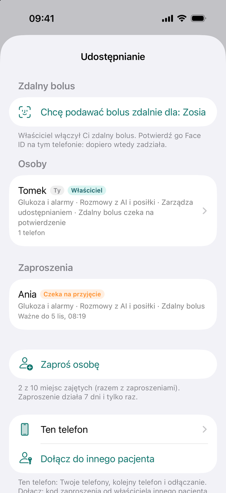
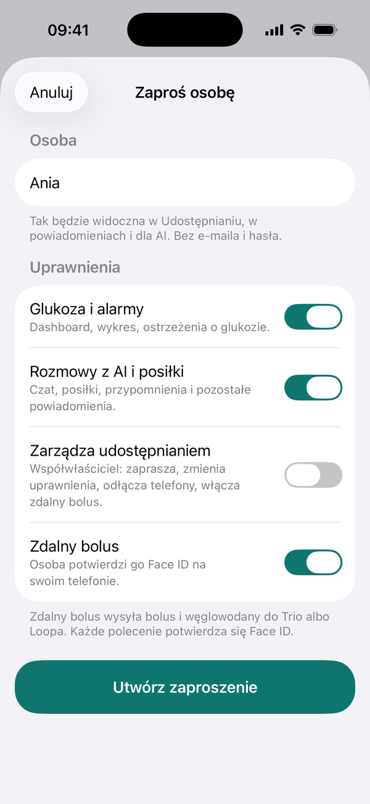
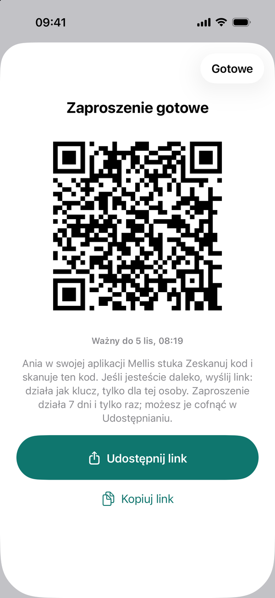

# 4. Połącz telefony z serwerem

Mellis nie ma kont, e-maili ani haseł. Każdy telefon łączy się z serwerem raz, a potem rozpoznaje się sam własnym
kluczem schowanym w Secure Enclave telefonu.

## Twój telefon

Zwykle nic nie musisz robić: połączył się sam podczas [instalacji aplikacji](aplikacja.md). Jesteś
**właścicielem**: możesz zapraszać innych, zmieniać ich uprawnienia i włączać zdalny bolus.

??? failure "Aplikacja pokazuje ekran łączenia z serwerem"
    Kod konfiguracji mógł wygasnąć albo był źle wpisany. Połącz się z serwerem (komenda `ssh` z notatki), wpisz
    `mellis` i wybierz **Połącz telefon właściciela**. Zeskanuj pokazany kod QR w aplikacji. Kod działa 10 minut.
    Gdy na serwerze jest kilku właścicieli, Mellis najpierw zapyta **Kogo połączyć?**: wybierz siebie z listy.

<figure markdown>
{ loading=lazy }
<figcaption>Ekran łączenia: zeskanuj kod QR, wklej link albo użyj kodu odzyskiwania.</figcaption>
</figure>

<figure markdown>
{ loading=lazy }
<figcaption>Przed połączeniem aplikacja pokazuje adres serwera. Łącz tylko z serwerem swojej rodziny.</figcaption>
</figure>

## Kolejny opiekun

1.  **Zainstaluj aplikację na jego telefonie**

    Tym samym skryptem na swoim Macu. Jego telefon musi być raz przy Twoim Macu: zobacz
    [Pierwszy raz z nowym telefonem](aplikacja.md#pierwszy-raz-z-nowym-telefonem). Aplikacja pokaże ekran łączenia
    z serwerem.

2.  **Utwórz zaproszenie na swoim telefonie**

    **Mellis → Ustawienia → Udostępnianie → Zaproś osobę**. Wpisz imię i wybierz uprawnienia:

    | Uprawnienie | Co daje |
    |---|---|
    | Glukoza i alarmy | dashboard, wykres, ostrzeżenia o glukozie |
    | Rozmowy z AI i posiłki | czat, posiłki, przypomnienia i pozostałe powiadomienia |
    | Zarządza udostępnianiem | **współwłaściciel**: to samo co Ty, także zapraszanie i zdalny bolus dla innych |
    | Zdalny bolus | wysyłanie bolusa i węglowodanów do Trio albo Loopa (wymaga też „Rozmowy z AI i posiłki”) |

    Zdalny bolus jest domyślnie wyłączony i może go włączyć tylko właściciel.

3.  **Pokaż kod QR**

    Druga osoba w swojej aplikacji stuka najpierw **Rozumiem i akceptuję** (Mellis to projekt DIY, nie wyrób
    medyczny; tylko raz na telefonie), potem **Zeskanuj kod** i skanuje kod z Twojego ekranu. Jeśli jesteście daleko od
    siebie, wyślij jej link z zaproszenia. Link działa jak klucz: wyślij go tylko tej osobie.

    Zaproszenie działa **7 dni i tylko raz**. Możesz je w każdej chwili cofnąć.

4.  **Druga osoba przyjmuje zaproszenie**

    Jeśli zaproszenie zawiera zdalny bolus, druga osoba potwierdza go Face ID na swoim telefonie.

<figure markdown>
{ loading=lazy }
<figcaption>Udostępnianie: osoby z uprawnieniami, otwarte zaproszenia i Zaproś osobę.</figcaption>
</figure>

<figure markdown>
{ loading=lazy }
<figcaption>Zaproś osobę: imię i uprawnienia.</figcaption>
</figure>

<figure markdown>
{ loading=lazy }
<figcaption>Gotowe zaproszenie: kod QR do zeskanowania albo link do wysłania.</figcaption>
</figure>

## Kolejny podopieczny

Na jednym serwerze może być kilka osób, każda z własnym Nightscoutem.

- Dodajesz ją w **Mellis → Ustawienia → Dodaj pacjenta**. Potrzebny będzie jej adres Nightscouta i token tylko do
  odczytu. Ty zostajesz jej właścicielem.
- W aplikacji przełączasz się strzałką przy imieniu na górze ekranu.
- Gdy telefon dostaje powiadomienia o kilku osobach, tytuł zaczyna się od imienia.

## Zmiana telefonu

=== "Nowy telefon, stary jeszcze działa"

    Na starym telefonie: **Mellis → Ustawienia → Udostępnianie → Ten telefon → Połącz kolejny telefon**. Zeskanuj
    kod nowym telefonem (działa 10 minut). Nowy telefon ma te same uprawnienia co stary. Potem odłącz stary.

=== "Stary telefon zaginął"

    - **Inny opiekun:** właściciel zaprasza go ponownie i usuwa jego starą pozycję z listy osób.
    - **Właściciel, gdy jest drugi właściciel:** drugi właściciel zaprasza Cię ponownie z uprawnieniem „Zarządza
      udostępnianiem”.
    - **Jedyny właściciel:** na nowym telefonie w ekranie łączenia wybierz **Mam kod odzyskiwania** i wpisz kod
      z notatki. Nie masz kodu? Połącz się z serwerem, wpisz `mellis` i wybierz **Odzyskaj dostęp właściciela**:
      dostęp do serwera wystarczy jako dowód.

    Potem odłącz zgubiony telefon: **Mellis → Ustawienia → Udostępnianie →** osoba **→** urządzenie **→ Odłącz**.
    Odłączony telefon traci dostęp od razu.
