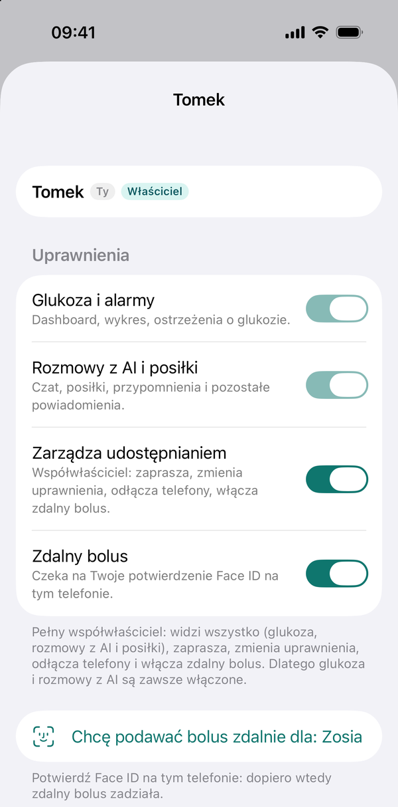
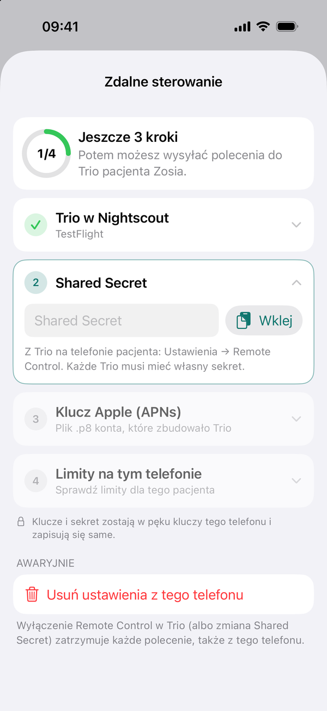

# 5. Zdalny bolus (Trio, Loop)

ok. 5 minut · opcjonalnie

Mellis może wysłać bolus i węglowodany do pętli na telefonie podopiecznego, tak jak Loop Follow albo Nightscout.
Polecenie wysyła **Twój telefon prosto do Trio albo Loopa**, przez powiadomienia Apple. Serwer Mellis najpierw
sprawdza, czy polecenie jest podpisane Twoim Face ID, i zapisuje je w historii, ale sam nie może wysłać bolusa.

!!! danger "Zanim włączysz"
    - Włącz zdalne polecenia najpierw w samej pętli i sprawdź, że działają, np. z Nightscouta albo Loop Follow.
    - Trio i Loop sprawdzają swój maksymalny bolus i limity węglowodanów. Mellis ich nie obejdzie, a jego limity
      ustaw nie luźniej niż w pętli.
    - Każde polecenie potwierdzasz Face ID. Ekran potwierdzenia zawsze pokazuje imię podopiecznego i dawkę.
    - Mellis to projekt DIY, nie wyrób medyczny: decyzje o leczeniu podejmujesz Ty. Potwierdzając zdalny bolus Face
      ID, akceptujesz to. Telefon, który jeszcze tego nie zaakceptował, pokaże nad suwakiem przełącznik
      **Rozumiem i akceptuję**: bez niego suwak się nie włączy.

## Kto może

Zdalny bolus włącza **właściciel**, osobno dla każdej osoby, także dla siebie: **Mellis → Ustawienia →
Udostępnianie →** osoba **→ Zdalny bolus**. Każdy potwierdza to Face ID na swoim telefonie. Po włączeniu w aplikacji
pojawia się wiersz **Zdalne sterowanie Trio** (albo **Loop**) i, po jego ustawieniu, karta **Bolus**.

<figure class="screen" markdown>
{ loading=lazy }
<figcaption>Właściciel włączył zdalny bolus. Dopiero po potwierdzeniu Face ID na Twoim telefonie zacznie działać.</figcaption>
</figure>

## Czego potrzebujesz

=== "Trio"

    To samo, co do zdalnych poleceń z Nightscouta albo Loop Follow:

    - **Shared Secret**: w Trio **koło zębate → Funkcje → Kontrola zdalna**,
    - **plik `.p8`** klucza APNs konta, które zbudowało Trio, i jego **Key ID**.

=== "Loop"

    - **Kod QR zdalnych poleceń**: w Loopie **koło zębate → Nightscout** (w sekcji Usługi) **→ One-Time Password**.
      Zrób zrzut ekranu z kodem albo zeskanuj go aparatem Mellisa z drugiego telefonu,
    - **plik `.p8`** klucza APNs konta, które zbudowało Loopa, i jego **Key ID**. Mellis zapyta też o **Team ID**,
      jeśli nie odczyta go z Nightscouta.

### Jak przenieść plik `.p8` na iPhone'a

Mellis wczytuje plik `.p8` z aplikacji **Pliki** na telefonie:

1. Na Macu kliknij plik prawym przyciskiem → **Udostępnij → AirDrop** → wybierz swój iPhone.
2. Na iPhonie wybierz **Zapisz w Plikach** (np. w folderze „Na moim iPhonie”).
3. Po wczytaniu w Mellisie usuń plik z aplikacji Pliki. Klucz zostaje w pęku kluczy telefonu.

## Włącz w Mellisie

1.  **Mellis → Ustawienia → Zdalne sterowanie Trio** (albo **Loop**).

    Mellis sam sprawdzi w Nightscoucie, czy pętla przyjmuje polecenia zdalne.

2.  **Wklej Shared Secret** albo **zeskanuj kod QR Loopa**: aparatem, ze zdjęcia albo z pliku.

3.  **Wczytaj plik `.p8`.** Key ID uzupełni się z nazwy pliku.

4.  **Klucz do odpowiedzi** (tylko gdy pętlę zbudowało inne konto Apple niż Mellisa).

    Trio i Loop odpowiadają Mellisowi, że polecenie dotarło. Jeśli pętlę zbudowało inne konto, Mellis poprosi
    o drugi plik `.p8`: z konta, którym zbudowałeś Mellisa.

5.  **Sprawdź limity.** Mellis pokaże krok pompy i maksymalny bolus oraz węglowodany. Porównaj je z ustawieniami
    w Trio albo w Loopie: w Mellisie nie mogą być większe.

<figure class="screen" markdown>
{ loading=lazy }
<figcaption>Zdalne sterowanie Trio: Mellis sam sprawdził Trio w Nightscoucie, teraz wklejasz Shared Secret.</figcaption>
</figure>

Klucze i sekret zostają w pęku kluczy tego telefonu. Serwer ich nie dostaje: ma tylko własny klucz do powiadomień,
którym nie da się wysłać polecenia do pętli bez Shared Secret albo kodu z Loopa.

Każdy opiekun z uprawnieniem do zdalnego bolusa robi to raz na swoim telefonie albo dostaje gotowe ustawienia od
właściciela (niżej).

## Przekaż ustawienia drugiej osobie

Gdy zdalne sterowanie działa już na telefonie właściciela, nie trzeba przepisywać sekretu, kluczy `.p8` ani limitów
na telefonie każdej osoby. Właściciel przekazuje swoje.

**Właściciel**

1. Włącz osobie zdalny bolus: **Mellis → Ustawienia →** pacjent **→ Osoby i udostępnianie →** osoba **→ Zdalny
   bolus → Zapisz**. Mellis od razu zapyta: **Przekazać też Twoje ustawienia Trio?** (albo **Loop**).
2. Wybierz **Przekaż ustawienia** albo później, na tej samej stronie, **Przekaż moje ustawienia Trio** (albo **Loop**).
3. Potwierdź Face ID. Pod przyciskiem widać, czy telefon tej osoby już je odebrał. Nieodebrane możesz **Cofnąć**.

**Osoba, która dostaje ustawienia**

1. Otwórz Mellisa. Pojawi się **Tomek przekazał Ci ustawienia Trio dla: Zosia** (to samo jest też w **Ustawienia →**
   pacjent **→ Zdalny bolus**).
2. Wybierz **Zapisz**. Gdy zdalny bolus jest już potwierdzony na tym telefonie, Mellis poprosi o Face ID: tylko
   z nim telefon odczyta przekazane ustawienia.
3. **Zdalne sterowanie Trio** pokaże **Gotowe do wysyłania**. Limity są takie jak u właściciela; możesz je
   zaostrzyć, ale nie mogą być luźniejsze niż w pętli.

**Odrzuć** usuwa przekazane ustawienia. Czekają 7 dni i można je zapisać tylko raz, tylko na telefonie, dla którego
zostały zaszyfrowane: serwer przechowuje je zaszyfrowane i nie może ich odczytać. Gdy nie ma czego przekazać (pętla
właściciela nie jest ustawiona w Mellisie), każdy ustawia zdalne sterowanie ręcznie, jak wyżej.

!!! note "Pierwszy bolus"
    Wyślij pierwszy raz mały bolus, gdy podopieczny jest obok, i sprawdź w Trio albo Loopie, że dotarł. Mellis
    pokaże, czy pętla potwierdziła polecenie.
